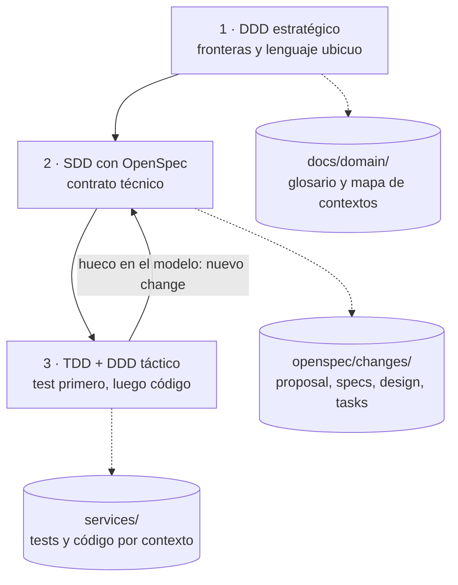
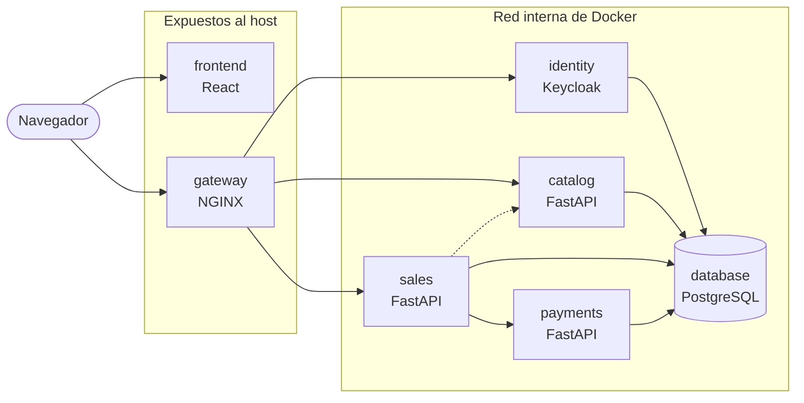

# Plan del proyecto: Ticketera virtual para eventos

| Campo | Valor |
|---|---|
| Versión | 0.4.0 |
| Estado | Borrador para aprobación del equipo |
| Última actualización | 2026-10-15 |
| Responsable del documento | Integrante B (actualización de propuestas) |
| Fuentes | Consigna «Trabajo final de Tópicos II – 2026»; notas de la clase (lineamiento y profundización) |

> Este plan es un documento vivo. Solo se modifica mediante Pull Request, siguiendo el
> procedimiento de la sección 10. Cada cambio se registra en la sección 11.
> Todo lo marcado como **Pendiente** es una propuesta sujeta a la aprobación del equipo.

## Índice

1. [Propósito y alcance](#1-propósito-y-alcance)
2. [Requisitos](#2-requisitos)
3. [Método de trabajo: DDD, SDD y TDD](#3-método-de-trabajo-ddd-sdd-y-tdd)
4. [Arquitectura](#4-arquitectura)
5. [Decisiones propuestas](#5-decisiones-propuestas)
6. [Organización del equipo y flujo de trabajo](#6-organización-del-equipo-y-flujo-de-trabajo)
7. [Plan por etapas](#7-plan-por-etapas)
8. [Estructura del repositorio](#8-estructura-del-repositorio)
9. [Documentos relacionados](#9-documentos-relacionados)
10. [Cómo modificar este plan](#10-cómo-modificar-este-plan)
11. [Registro de cambios](#11-registro-de-cambios)
12. [Anexo: preguntas para el Event Storming](#12-anexo-preguntas-para-el-event-storming)

---

## 1. Propósito y alcance

Plataforma de ticketera virtual para eventos, construida con microservicios y con un método
que combina **Domain-Driven Design** (DDD), **Spec-Driven Development** (SDD) con OpenSpec y
**Test-Driven Development** (TDD).

Según el lineamiento de la cátedra, **se evalúa el diseño, no la escala**: no hace falta soportar
miles de usuarios concurrentes, pero la arquitectura debe permitir escalar y cada decisión debe
poder justificarse en las entrevistas individuales.

### 1.1 Actores

Estos nombres forman parte del lenguaje ubicuo y se usan igual en specs y código.

| Rol | Descripción |
|---|---|
| `ADMIN` | Gestión completa de la plataforma, mantenimiento y tareas operativas. Aprueba o rechaza devoluciones. |
| `EVENT_OWNER` | Diseña, configura y publica eventos. |
| `CLIENT` | Explora los eventos publicados y compra tickets. Solicita devoluciones. |

### 1.2 Etapas

| Etapa | Alcance según la consigna |
|---|---|
| I · Core | Backend, APIs, autenticación, compra de tickets, mockups |
| II | Integración con sistema de recomendación y cache |
| III · Escalabilidad | Colas de venta, devoluciones, búsqueda avanzada y stress test |

### 1.3 Fuera de alcance (non-goals propuestos)

- Pasarelas de pago reales: los pagos se simulan.
- Emisión de QR, validación en puerta, transferencia y reventa de entradas (las menciona la clase
  como dominio posible, pero la consigna no las pide). La emisión de QR puede sumarse al final si sobra tiempo.
- Aplicaciones móviles nativas.
- Despliegue en la nube: el entorno objetivo es Docker Compose.

---

## 2. Requisitos

### 2.1 Requisitos base (obligatorios)

No se debaten: definen el marco dentro del cual se toman las decisiones de la sección 5.

| ID | Requisito | Cómo se cumple | Verificación |
|---|---|---|---|
| RB-01 | Cada tarea se desarrolla en su propia rama (*feature branch*) y se integra mediante Pull Request. | GitHub Flow; ramas `feature/<tema>` (6.2). | Historial de PR. |
| RB-02 | El repositorio es público. | Visibilidad *Public*; licencia (D-11). | Configuración del repositorio. |
| RB-03 | El equipo está formado por tres personas. | Reparto por contextos y revisión cruzada (6.1). | — |
| RB-04 | No se permite el push directo a `main`. | Ruleset sin excepciones (6.3). | Un push directo a `main` es rechazado. |
| RB-05 | Todo PR es revisado por otro integrante, incluido el código generado por IA, y el uso de IA se declara. | Una aprobación obligatoria; aprobación del último push por otra persona; sección de IA en la plantilla de PR. | Ningún PR integrado sin aprobación humana. |
| RB-06 | Se usa OpenSpec con flujo SDD: propuesta, diseño (con decisiones y alternativas descartadas) y tareas antes del código. | Changes de OpenSpec; reglas del `config.yaml`. | `openspec validate --all --strict` en la CI. |
| RB-07 | El copiloto de IA (OpenCode sugerido por la cátedra, u otro) ejecuta comandos de OpenSpec. | Integraciones generadas con `openspec init`; reglas comunes en `AGENTS.md`. | El copiloto ejecuta `openspec validate`. |
| RB-08 | `main` protegida, con CI y al menos una revisión para el merge. | Ruleset con aprobación y status checks obligatorios. | El merge está bloqueado sin aprobación o con la CI en rojo. |
| RB-09 | Docker y Docker Compose: **todo el sistema se levanta con un único `docker compose up`**; cada servicio tiene volumen definido desde la carpeta donde se construye su código. | Un contenedor por microservicio (4.4); esqueleto andante desde el bootstrap (7.1.1). | `docker compose up --wait` y prueba de humo en la CI. |
| RB-10 | Todo el proyecto vive en un único repositorio. | Monorepo (sección 8). | Estructura del repositorio. |
| RB-11 | El plan se versiona como Markdown y puede cambiar. | Este documento, modificado solo por PR. | Registro de cambios. |
| RB-12 | Ninguna feature se integra si no pasa sus tests; los tests se escriben antes que el código (TDD). | Checks obligatorios de la CI; tareas de test antes que las de implementación (3.4). | CI en verde; commits `test` antes que `feat` en cada PR. |
| RB-13 | Las fronteras, la arquitectura y la comunicación de los microservicios se basan en DDD. | Bounded contexts y lenguaje ubicuo en `docs/domain/` (3.2). | Specs y código usan los términos del glosario. |
| RB-14 | Cada integrante puede explicar y justificar cualquier decisión del sistema. | Revisión cruzada como transferencia de conocimiento; ADR y changes archivados. | Entrevistas individuales. |

### 2.2 Desafíos funcionales de la consigna

| ID | Desafío | Etapa | Contexto previsto |
|---|---|---|---|
| DF-01 | Un ticket no se vende dos veces (idempotencia y control de concurrencia). | I | `sales` |
| DF-02 | Entradas numeradas (asiento) y no numeradas (zona), con reglas distintas. | I | `catalog`, `sales` |
| DF-03 | Devoluciones: el `CLIENT` solicita, el `ADMIN` aprueba o rechaza, se libera el asiento o la zona. | III | `sales` |
| DF-04 | Eventos masivos: encolar solicitudes, notificar la posición y procesar en orden. | III | `sales-queue` |
| DF-05 | Recomendaciones personalizadas según historial y preferencias. | II | `recommendation` |
| DF-06 | Búsqueda por tipo, organizador, participante y fecha, ordenada por relevancia. | III (datos desde la I) | `catalog`, `search` |

### 2.3 Desafíos técnicos de la consigna

| ID | Desafío | Etapa | Enfoque propuesto |
|---|---|---|---|
| DT-01 | Evitar la doble venta: locks optimistas o pesimistas, transacciones distribuidas, claves de idempotencia. | I | Reserva y orden en el mismo contexto (transacción local); claves de idempotencia; Saga para flujos entre servicios. |
| DT-02 | Arquitectura de microservicios: límites, comunicación sync/async, fallos parciales, consistencia eventual, despliegue independiente. | I a III | Límites por DDD; REST en la Etapa I; eventos de integración con RabbitMQ desde la II. |
| DT-03 | Bitácora de solicitudes HTTP con medición de tiempos. | I | Middleware en cada servicio: timer → autenticación → registro de resultado y duración → respuesta. |
| DT-04 | Estrategias de cache: qué, dónde, invalidación y TTL. | II | Redis; el design cubre las cuatro dimensiones. |
| DT-05 | Colas de venta: infraestructura, *backpressure*, procesamiento asíncrono y notificaciones en tiempo real. | III | RabbitMQ y WebSocket o SSE. |

### 2.4 Entregables de la consigna

| ID | Entregable | Ubicación |
|---|---|---|
| E-01 | `CONTRIBUTE.md` con el flujo de trabajo (feature branch, tests, CI) | Raíz del repositorio |
| E-02 | Changes archivados con specs, design y tasks | `openspec/changes/archive/` |
| E-03 | Mockups, APIs funcionales y tests de unidad | `docs/mockups/`, `services/`, `frontend/` |
| E-04 | Bitácora de documentación | `docs/bitacora/` (ver S-02) |

### 2.5 Supuestos a confirmar con el docente

| ID | Supuesto | Si no se confirma |
|---|---|---|
| S-01 | Una etapa puede gestionarse con **varios changes**, uno por feature, agrupados con prefijo (D-14). | Un único change por etapa, con una carpeta de spec por contexto. |
| S-02 | La «bitácora de documentación» es un registro de trabajo del equipo: fecha, autor, qué se hizo, decisiones y uso de IA. | Se adapta al formato que indique la cátedra. |
| S-03 | «Participante» en la búsqueda designa a quienes actúan en el evento (artistas, oradores, equipos), no a los asistentes. | Se ajusta el modelo del catálogo. |

---

## 3. Método de trabajo: DDD, SDD y TDD

### 3.1 Visión general



### 3.2 DDD estratégico: las fronteras

- **Subdominios**: áreas del negocio. *Núcleo* (lo que diferencia al sistema: vender sin doble venta),
  *de soporte* (propios pero no diferenciales) y *genéricos* (conviene reutilizarlos, como la autenticación).
- **Bounded context**: frontera dentro de la cual un modelo y su vocabulario son consistentes. Cada uno
  se implementa como un microservicio.
- **Lenguaje ubicuo**: vocabulario compartido por el equipo, las specs y el código. Vive en
  `docs/domain/glossary.md` (término en inglés, definición en español).
- **Mapa de contextos**: cómo se relacionan los contextos (quién depende de quién y cómo se traducen
  los modelos). Vive en `docs/domain/context-map.md`.
- **Técnica**: un taller de **Event Storming** del equipo, tomando como referencia plataformas reales de
  venta de entradas. El resultado se valida con el docente. El anexo (sección 12) lista preguntas de partida.

### 3.3 SDD: el contrato

Cada feature es un change de OpenSpec (D-14) escrito con el lenguaje ubicuo:

- **proposal**: por qué, qué cambia, impacto y *non-goals*.
- **specs**: requisitos (SHALL/MUST) con escenarios WHEN/THEN, incluidos errores, concurrencia y autorización por rol.
- **design**: *Goals*, *Non-Goals*, *Decisions* y *Alternatives Considered*; modelo táctico (agregados,
  invariantes, eventos de dominio); contrato OpenAPI; estrategia de concurrencia e idempotencia.
- **tasks**: tareas pequeñas, con la tarea de test antes que la de implementación.

### 3.4 TDD: la implementación

Cada tarea se implementa en dos lazos:

1. **Lazo externo (aceptación)**: cada escenario de la spec se convierte en un test de API que falla.
2. **Lazo interno (unitario)**: tests del **DDD táctico** que modelan el dominio, cada uno con el ciclo
   **rojo → verde → refactor**:
   - *entidad*: objeto con identidad propia (una orden);
   - *objeto de valor*: definido solo por sus atributos (un precio con su moneda);
   - *agregado*: grupo de objetos que se modifican juntos y protegen sus invariantes
     («no se reserva un asiento ya vendido»);
   - *evento de dominio*: hecho relevante ocurrido («pago confirmado»).

Reglas:

- **Trazabilidad**: cada test indica en su docstring el requisito y el escenario que verifica.
- **Evidencia de test-first**: en cada PR, el commit `test(...)` en rojo precede al `feat(...)` en verde.
  GitHub conserva esos commits en la página del PR aunque se integre con *squash*.
- **Niveles de test**: unitarios (dominio y aplicación, sin base de datos), de integración
  (repositorios con PostgreSQL real) y de aceptación (API).
- **Puerta de calidad**: tests, lint y type check en verde, y cobertura mínima del 80 % en `domain`
  y `application` (D-18).
- **Frontend**: tests de la lógica y de los componentes críticos con Vitest y React Testing Library.

---

## 4. Arquitectura

### 4.1 Contextos candidatos

Hipótesis inicial, a validar en el Event Storming (los nombres en código van en inglés).

| Contexto | Subdominio | Responsabilidad | Etapa |
|---|---|---|---|
| `identity` | Genérico | Usuarios, roles y autenticación (Keycloak) | I |
| `catalog` | Soporte | Eventos, tipos, sedes, zonas, mapa de asientos, participantes, publicación | I |
| `sales` | **Núcleo** | Disponibilidad, reservas temporales, órdenes, tickets, idempotencia; devoluciones en la III | I |
| `payments` | Genérico | Pago simulado e idempotente | I |
| `recommendation` | Soporte | Recomendaciones según historial y preferencias | II |
| `search` | Soporte | Índice de búsqueda alimentado por eventos del catálogo | III |
| `sales-queue` | Soporte | Sala de espera, posición en la cola, notificaciones | III |

Reservas, órdenes y disponibilidad quedan juntas en `sales` para que reservar un asiento y crear la orden
ocurran en una **transacción local**, sin transacción distribuida justo donde está el riesgo de doble venta.

### 4.2 Vista general (Etapa I)



### 4.3 Arquitectura interna de cada servicio (hexagonal)

```text
services/sales/
├── Dockerfile
├── pyproject.toml
├── src/sales/
│   ├── domain/           # Modelo puro: agregados, objetos de valor, eventos. Sin FastAPI ni base de datos.
│   ├── application/      # Casos de uso: orquestan el dominio a través de puertos (interfaces).
│   ├── infrastructure/   # Adaptadores: repositorios con SQLAlchemy, mensajería, clientes HTTP.
│   └── api/              # Routers de FastAPI, esquemas Pydantic, middleware de bitácora.
└── tests/
    ├── unit/             # Dominio y aplicación (rápidos, sin base de datos)
    ├── integration/      # Repositorios contra PostgreSQL real
    └── acceptance/       # Escenarios de la spec a nivel de API
```

El dominio no depende de nada externo: por eso se puede testear con pytest sin levantar servicios.

### 4.4 Contenedores (`docker-compose.yml` en la raíz)

| Contenedor | Se construye desde | Volumen | Tipo | Expuesto al host |
|---|---|---|---|---|
| `frontend` | `./frontend` | `./frontend` (código) | Bind mount | Sí |
| `gateway` | Imagen oficial de NGINX | `./infra/gateway` (configuración) | Bind mount | Sí, único acceso a la API |
| `identity` | Imagen oficial de Keycloak | `./infra/keycloak` (realm con los roles, importado al arrancar) | Bind mount | Solo la consola, en desarrollo |
| `catalog` | `./services/catalog` | `./services/catalog` (código) | Bind mount | No |
| `sales` | `./services/sales` | `./services/sales` (código) | Bind mount | No |
| `payments` | `./services/payments` | `./services/payments` (código) | Bind mount | No |
| `database` | Imagen oficial de PostgreSQL | `ticketera-db-data` (datos) y `./infra/database` (scripts de inicialización) | Volumen con nombre y bind mount | Opcional, en desarrollo |

- **Un único comando**: `docker compose up` desde la raíz levanta todos los contenedores; nadie instala
  dependencias del proyecto en su máquina.
- **Arranque ordenado**: cada contenedor declara un *healthcheck* (comprobación periódica de que está
  funcionando) y los servicios esperan a que `database` e `identity` estén sanos (`depends_on` con
  `condition: service_healthy`).
- **Una base lógica por servicio** dentro de `database` (`catalog`, `sales`, `payments`, `keycloak`),
  creadas por los scripts de `./infra/database` en el primer arranque, con credenciales exclusivas.
- **Red interna**: solo `frontend` y `gateway` se exponen al host.
- **Secretos** en `.env` (ignorado por Git); en el repositorio solo `.env.example`.
- **Dependencias aisladas**: las carpetas de dependencias (`.venv`, `node_modules`) se declaran como
  volúmenes anónimos para que el bind mount del código no las oculte.

### 4.5 Comunicación y consistencia

| Etapa | Mecanismo | Uso |
|---|---|---|
| I | REST sincrónico con claves de idempotencia | Compra, pago simulado, consultas al catálogo |
| I | Eventos de integración **documentados** en el design | Contrato preparado para la mensajería |
| II | RabbitMQ (asíncrono, consistencia eventual) | El historial de compras alimenta `recommendation` |
| III | RabbitMQ + WebSocket o SSE | Cola de venta con posición en tiempo real; índice de `search` |

### 4.6 Bitácora de solicitudes HTTP (DT-03)

Middleware en cada servicio, en este orden: iniciar el timer al recibir la solicitud, procesar la
autenticación, ejecutar el endpoint, registrar método, ruta, usuario, código de estado y duración, y
devolver la respuesta. Los rechazos de autenticación también se registran. El formato y el almacenamiento
se definen en el design del change `e1-request-log`.

### 4.7 Crecimiento por etapas

| Etapa | Contenedores que se agregan |
|---|---|
| II | `redis` (cache), `rabbitmq` (mensajería), `recommendation` |
| III | `sales-queue`, `search` (motor según D-21); pruebas de estrés según D-22 |

---

## 5. Decisiones propuestas

Estado: **Pendiente** (en discusión), **Aprobada** (registrada en un ADR) o **Reemplazada**.
Al aprobarse, cada decisión se documenta en `docs/adr/` y se actualiza `openspec/config.yaml`.

### 5.1 Tecnología

| ID | Decisión | Propuesta | Alternativas | Estado |
|---|---|---|---|---|
| D-01 | Frontend | React + TypeScript + Vite | Angular, Vue | Pendiente |
| D-02 | Backend | Python + FastAPI | NestJS, Spring Boot | Pendiente |
| D-03 | Identidad | Keycloak (OAuth 2.0 / OIDC, RBAC) | Servicio propio en FastAPI con JWT | Pendiente |
| D-04 | API Gateway | NGINX | Kong, Traefik | Pendiente |
| D-05 | Contenedores | Uno por microservicio | Monolito modular en un contenedor | Pendiente |
| D-06 | Base de datos | Un contenedor PostgreSQL, una base lógica por servicio | Un contenedor por base | Pendiente |
| D-07 | Mensajería | RabbitMQ desde la Etapa II | Kafka; mensajería desde la Etapa I | Pendiente |
| D-15 | Herramientas de Python | uv, SQLAlchemy 2 + Alembic, Ruff, mypy, pytest + pytest-cov | pip, Poetry, SQLModel, pyright | Pendiente |
| D-16 | Herramientas de frontend | Vitest + React Testing Library; Tailwind CSS con shadcn/ui | MUI; Jest; sin librería de componentes | Pendiente (propuesta por B) |
| D-17 | Arquitectura interna de los servicios | Hexagonal (puertos y adaptadores) | Capas tradicionales (routers → servicios → modelos ORM) | Pendiente |
| D-21 | Motor de búsqueda (Etapa III) | Se decide en la Etapa III | OpenSearch o búsqueda de texto completo de PostgreSQL | Diferida |
| D-22 | Stress test (Etapa III) | Se decide en la Etapa III | k6 o Locust | Diferida |

### 5.2 Proceso y organización

| ID | Decisión | Propuesta | Alternativas | Estado |
|---|---|---|---|---|
| D-08 | Reparto de trabajo | Provisorio por contexto (6.1); definitivo tras el Event Storming | Otra asignación | Pendiente |
| D-09 | Idioma | Artefactos de OpenSpec, código y commits en inglés; plan, `CONTRIBUTE.md` y bitácora en español; glosario bilingüe | Todo en español salvo el código | Pendiente |
| D-10 | Copiloto de IA | Libre, compatible con OpenSpec; reglas comunes en `AGENTS.md` (soporte para Claude Code, Gemini en Antigravity IDE y OpenCode) | Copiloto único para todo el equipo | Pendiente |
| D-11 | Licencia | MIT | Sin licencia | Pendiente |
| D-12 | Entorno de desarrollo | *Docker-only* parcial: en el host solo Git, Docker Desktop, VS Code, el copiloto y OpenSpec (con Node.js); todo lo del proyecto en contenedores | Dev Containers (todo dentro del contenedor) | Pendiente |
| D-13 | Método de merge | Squash and merge | Merge commit, rebase | Pendiente |
| D-14 | Granularidad de los changes | Uno por feature, con prefijo de etapa (S-01) | Uno por etapa | Pendiente |
| D-18 | Cobertura mínima | 80 % en `domain` y `application` | Umbral global; sin umbral | Pendiente |
| D-19 | Pre-commit hooks | Livianos (formato y lint), ejecutados dentro de Docker | Sin hooks | Pendiente |
| D-20 | Seguimiento de tareas | GitHub Issues; cada PR las cierra con `Closes #n` | Solo `tasks.md` | Pendiente |

---

## 6. Organización del equipo y flujo de trabajo

### 6.1 Reparto provisorio y revisión cruzada

| Integrante | Responsabilidad | Revisa los PR de |
|---|---|---|
| A | `identity`, gateway, plataforma (Compose, CI), bitácora HTTP | C |
| B | `catalog` | A |
| C | `sales`, `payments` | B |

- Los cambios en `docs/PLAN.md`, `docs/domain/` y `openspec/config.yaml` los revisan los otros dos integrantes.
- La revisión no solo aprueba: es la transferencia de conocimiento que permite a cada integrante
  explicar todo el sistema en las entrevistas (RB-14).
- El reparto definitivo se acuerda después del Event Storming.

### 6.2 Flujo de Git (GitHub Flow)

1. Actualizar `main` (`git switch main` y `git pull`).
2. Crear la rama `feature/<change-o-tema>`, por ejemplo `feature/e1-ticket-inventory`.
3. Ciclo TDD con commits pequeños en Conventional Commits: `test(sales): ...` y luego `feat(sales): ...`.
4. Push de la rama y Pull Request hacia `main`, con `Closes #n` si resuelve una issue.
5. Revisión del integrante asignado (`CODEOWNERS`) y CI en verde.
6. Integración con *squash and merge*; la rama remota se borra automáticamente.

### 6.3 Protección de `main` (ruleset `proteger-main`)

- Lista de excepciones vacía; prohibido borrar la rama y hacer *force push*.
- Pull Request obligatorio con **una aprobación**.
- Aprobaciones invalidadas ante nuevos commits.
- Aprobación del último push por alguien distinto de quien lo hizo.
- Conversaciones resueltas antes del merge.
- **Status checks obligatorios** de la CI.

### 6.4 Integración continua (GitHub Actions)

Todo corre dentro de Docker Compose, igual que en las máquinas del equipo.

| Desde | Verificación |
|---|---|
| Bootstrap | `openspec validate --all --strict --no-interactive` |
| Bootstrap | `docker compose config` y `docker compose build` |
| Bootstrap | Lint (Ruff, ESLint) y type check (mypy, `tsc`) de cada servicio |
| Bootstrap | Tests (pytest, Vitest) de cada servicio |
| Bootstrap | `docker compose up --wait` y prueba de humo: cada `/health` responde a través del gateway; luego `docker compose down -v` |
| Etapa I | Cobertura mínima (D-18), cuando exista lógica de dominio |

Un check solo puede marcarse como obligatorio en el ruleset después de que el workflow corrió al menos una vez.

### 6.5 Copilotos de IA

- Cada integrante elige su copiloto, siempre que sea compatible con OpenSpec (D-10).
- `AGENTS.md` contiene las reglas comunes (DDD, TDD, *Docker-only*, convenciones). OpenCode lo lee
  directamente; `CLAUDE.md` lo importa con `@AGENTS.md` para Claude Code.
- Las integraciones se generan con `openspec init --tools claude,opencode`; otra herramienta se suma por PR.
- Los tres usan la misma versión de OpenSpec y el mismo perfil de workflows; `openspec update` se
  ejecuta solo en un PR dedicado.
- Se guía al copiloto paso a paso: primero explorar, después una feature a la vez. Nunca «hacé toda la ticketera».
- Cada PR declara qué IA se usó y para qué. Una IA puede asistir en la revisión, pero aprueba una persona.

### 6.6 Bitácora del equipo

`docs/bitacora/` con una entrada por semana: fecha, autor, qué se hizo, decisiones tomadas y uso de IA
(sujeto a S-02).

---

## 7. Plan por etapas

### 7.1 Bootstrap: change `project-bootstrap`

Siguiendo el lineamiento de la clase, el primer change de OpenSpec es el propio flujo de trabajo.

| Paso | Responsable | Acción |
|---|---|---|
| 1 | A | Crear la organización y el repositorio público en GitHub. |
| 2 | A | Commit inicial directo a `main` (el único): `openspec init --tools claude,opencode` con el perfil de workflows ampliado, `openspec/config.yaml` y `docs/PLAN.md`. |
| 3 | A | Activar el ruleset de `main` (todavía sin checks) y el método *squash and merge*. |
| 4 | A | En el copiloto: `/opsx:explore` y luego `/opsx:new project-bootstrap`. |
| 5 | A | Reglas y convenciones: `AGENTS.md` y `CLAUDE.md`, `CONTRIBUTE.md`, plantilla de PR, `CODEOWNERS`, `.gitignore`, `.gitattributes`, `.env.example`. |
| 6 | A | Esqueleto de plataforma: `docker-compose.yml`, `database` con sus scripts de inicialización, `gateway` con las rutas, `identity` con el realm y los roles, workflow de CI. |
| 7 | B | Esqueleto de `catalog` y del `frontend`. |
| 8 | C | Esqueleto de `sales` y `payments`. |
| 9 | A | Marcar los checks de la CI como obligatorios en el ruleset. |
| 10 | Todos | Clonar, copiar `.env.example` a `.env`, ejecutar `docker compose up` y practicar con `/opsx:onboard`. |
| 11 | A | `/opsx:archive project-bootstrap`. |

Los pasos 5 a 11 son tareas del change, cada una en su rama y con su PR. Los pasos 6 a 8 fijan tecnología,
así que requieren aprobadas las decisiones D-01 a D-06, D-12, D-15 y D-16.

#### 7.1.1 Esqueleto andante (*walking skeleton*)

Es la versión mínima del sistema que funciona de punta a punta, todavía sin lógica de negocio. Demuestra
desde el primer día que la arquitectura, Docker Compose y la CI funcionan juntos; después, cada feature se
agrega sobre algo que ya corre.

| Contenedor | Contenido mínimo |
|---|---|
| `database` | PostgreSQL con una base lógica y un usuario por servicio |
| `identity` | Keycloak con el realm del proyecto y los roles `ADMIN`, `EVENT_OWNER` y `CLIENT` |
| `gateway` | NGINX con una ruta por servicio (`/api/catalog`, `/api/sales`, `/api/payments`) y otra hacia Keycloak |
| `catalog`, `sales`, `payments` | FastAPI con estructura hexagonal vacía y un endpoint `GET /health` que informa el estado del servicio y su conexión a la base |
| `frontend` | React con una página de estado que consulta cada `/health` a través del gateway |

Incluso el esqueleto sigue TDD: el test de `/health` se escribe antes que el endpoint.

**Criterio de terminado:** en una máquina limpia, `git clone` + copiar `.env.example` a `.env` +
`docker compose up` deja todos los contenedores sanos, y la página del frontend muestra los servicios en verde.

### 7.2 Descubrimiento del dominio

| Paso | Responsable | Resultado |
|---|---|---|
| 1 | Todos | Taller de Event Storming (anexo, sección 12). |
| 2 | B | `docs/domain/glossary.md` (lenguaje ubicuo bilingüe). |
| 3 | C | `docs/domain/context-map.md` (contextos y relaciones). |
| 4 | A | ADR-0001 con las decisiones aprobadas; `PLAN.md` y `config.yaml` actualizados. |

### 7.3 Etapa I

Primero el problema difícil, después las features verticales. Cada change incluye su parte de frontend
y sus mockups.

| Orden | Change | Responsable | Alcance |
|---|---|---|---|
| 1 | `e1-ticket-inventory` | C | Disponibilidad numerada y no numerada, reservas con expiración, concurrencia (DF-01, DF-02, DT-01) |
| 2 | `e1-identity-access` | A | Login, roles, validación de tokens en el gateway, rutas protegidas en el frontend |
| 3 | `e1-event-catalog` | B | Eventos, tipos, sedes, zonas y asientos, participantes, publicación |
| 4 | `e1-request-log` | A | Bitácora HTTP con medición de tiempos (DT-03) |
| 5 | `e1-ticket-purchase` | C | Orden, idempotencia, pago simulado, emisión de tickets |

### 7.4 Etapas II y III (preliminar)

| Etapa | Changes previstos |
|---|---|
| II | `e2-integration-events` (RabbitMQ), `e2-recommendations`, `e2-cache-strategy` |
| III | `e3-sales-queue`, `e3-refunds`, `e3-advanced-search`, `e3-stress-test` |

Su planificación detallada y el reparto se agregan a este documento al cerrar la etapa anterior.

---

## 8. Estructura del repositorio

```text
ticketera/
├── .claude/                 # Integración de OpenSpec para Claude Code
├── .opencode/               # Integración de OpenSpec para OpenCode
├── .github/
│   ├── workflows/           # CI
│   ├── CODEOWNERS
│   └── pull_request_template.md
├── openspec/                # config.yaml, specs/ y changes/
├── frontend/                # React (Dockerfile propio)
├── services/
│   ├── catalog/             # FastAPI, arquitectura hexagonal (4.3)
│   ├── sales/
│   └── payments/
├── infra/
│   ├── gateway/             # Configuración de NGINX
│   └── keycloak/            # Definición del realm
├── docs/
│   ├── PLAN.md              # Este documento
│   ├── domain/              # Glosario y mapa de contextos
│   ├── adr/                 # Architecture Decision Records
│   ├── bitacora/            # Bitácora del equipo
│   └── mockups/
├── tests/load/              # Pruebas de estrés (Etapa III)
├── docker-compose.yml
├── .env.example
├── AGENTS.md                # Reglas comunes para los copilotos
├── CLAUDE.md                # Importa AGENTS.md
├── CONTRIBUTE.md
└── README.md
```

---

## 9. Documentos relacionados

| Documento | Ubicación |
|---|---|
| Configuración de OpenSpec | [`openspec/config.yaml`](../openspec/config.yaml) |
| Lenguaje ubicuo y mapa de contextos | [`docs/domain/`](domain/) |
| Decisiones de arquitectura | [`docs/adr/`](adr/) |
| Guía de contribución | [`CONTRIBUTE.md`](../CONTRIBUTE.md) |
| Reglas para copilotos | [`AGENTS.md`](../AGENTS.md) |

---

## 10. Cómo modificar este plan

1. Crear una rama `feature/plan-<tema>`.
2. Editar el documento y actualizar la versión:
   - **mayor** (1.0.0 → 2.0.0) si cambia un requisito base;
   - **menor** (0.2.0 → 0.3.0) si se aprueba, agrega o reemplaza una decisión, o se replanifica una etapa;
   - **parche** (0.2.0 → 0.2.1) para correcciones de redacción.
3. Agregar una fila al registro de cambios.
4. Abrir un Pull Request revisado por los otros dos integrantes.

---

## 11. Registro de cambios

| Versión | Fecha | Cambio | Autor | PR |
|---|---|---|---|---|
| 0.1.0 | 2026-10-05 | Borrador inicial para aprobación del equipo | Integrante A | — |
| 0.2.0 | 2026-10-11 | Consigna actualizada (desafíos y entregables); lineamiento de la clase; método DDD → SDD → TDD; React y FastAPI; contextos candidatos; copiloto libre; bootstrap como change; changes por feature; nuevas decisiones D-14 a D-22 | Integrante A | — |
| 0.3.0 | 2026-10-11 | El bootstrap incluye el esqueleto andante: todo el sistema se levanta con `docker compose up`; la CI levanta el stack y ejecuta una prueba de humo desde el bootstrap | Integrante A | — |
| 0.4.0 | 2026-10-15 | Integrante B registra acuerdo con D-01 a D-06, D-15; propone Tailwind CSS + shadcn/ui (D-16) e incorpora Gemini y Claude Code (D-10); entrega primer borrador de glosario (docs/domain/glossary.md) | Integrante B | — |

---

## 12. Anexo: preguntas para el Event Storming

No hace falta responderlas antes del taller; sirven para arrancar la discusión.

- ¿Cuánto dura una reserva temporal antes de liberarse?
- ¿Hay un límite de entradas por `CLIENT` y por evento?
- En una entrada no numerada, ¿el `CLIENT` elige la zona?
- ¿Cuál es el plazo para solicitar una devolución? ¿El reembolso es total o parcial?
- ¿Un `EVENT_OWNER` puede editar un evento publicado que ya tiene ventas? ¿Qué campos?
- ¿Qué pasa con las entradas vendidas si se cancela un evento?
- ¿Qué estados atraviesa un evento (borrador, publicado, agotado, finalizado, cancelado)?
- ¿Qué estados atraviesa una orden y un ticket?
