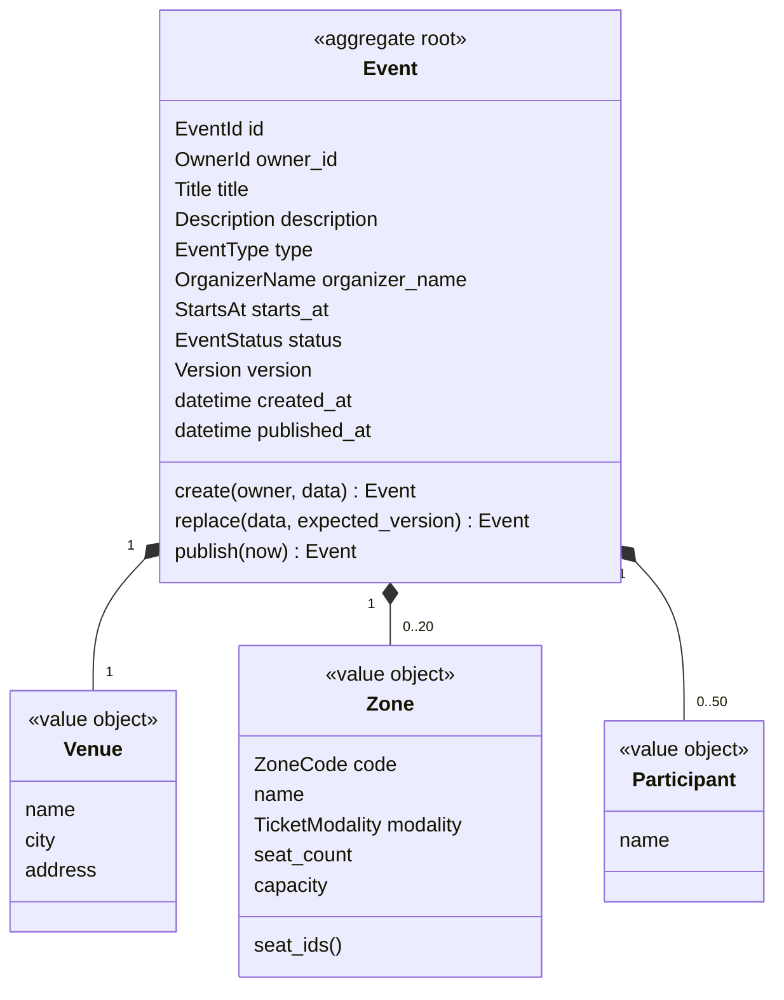
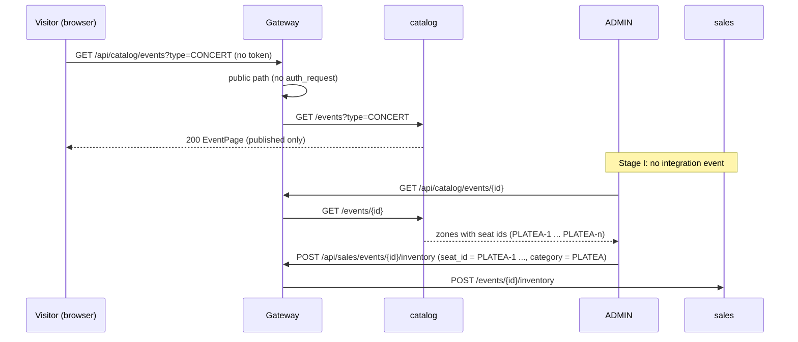

# Design

## Context

See `proposal.md` (Why, What Changes) for motivation and scope, and the four specs under `specs/` for the required
behavior. This document explains how `catalog`, the gateway and the frontend implement them.

Current state that shapes the approach:

- `catalog` has the four layers of D-33 (`domain/`, `application/`, `infrastructure/`, `api/`), a `/health`
  endpoint, its own database and role (D-06), and `root_path="/api/catalog"`. It has no tables and no Alembic yet.
- `e1-idempotent-purchase` (#32) fixes the reference skeleton:
  - `import-linter` contracts in the `quality` job, and Alembic per service;
  - the test layout `tests/unit/`, `tests/integration/`, `tests/acceptance/` and `tests/api/<service>/` (Bruno);
  - the `contract-test` check, which compares the committed `openapi.yaml` with the one FastAPI generates;
  - the idempotency pattern of D-30: a key table written in the same transaction, with
    `INSERT ... ON CONFLICT DO NOTHING` first.
- `e1-identity-access` (#30) protects every path at the gateway except `/api/<service>/health` and `/auth/`, with
  `auth_request` and a public-path map on the method and the raw URI (IA-03). Services decode the token without
  checking its signature, because the gateway validated it. On a public path the gateway validates nothing.
- `sales` keeps its own inventory per `event_id`, loaded by an `ADMIN`, with string `seat_id`s and a `category`,
  and never reads the catalog database (D-28, #32).
- `e1-request-log` (#34) adds the request log middleware; an authentication adapter stores the accepted `sub` in
  `request.state.user_id` (RL-06).
- There is no glossary yet (`docs/domain/` follows the Event Storming), and S-03 (who a participant is) is pending
  consultation; the plan's hypothesis is used: those who perform.

## Goals / Non-Goals

**Goals:**

- Let an `EVENT_OWNER` create, edit and publish their events, and an `ADMIN` any event, with ownership enforced in
  the service (OWASP API1).
- Let anyone browse the published events without signing in, without trusting any token on public paths.
- Model DF-02 (numbered and unnumbered zones) and the DF-06 data (type, organizer, participants, date) from Stage I.
- Give `sales` a stable `event_id` and deterministic seat ids to load its inventory.
- Follow the D-33 skeleton, contract-first (D-24), with idempotent creation and no lost updates.

**Non-Goals:**

- Prices, availability and selling (`sales`); the selling rules of unnumbered zones.
- States beyond `DRAFT` and `PUBLISHED`, editing published events, deleting events (Event Storming).
- Emitting integration events (Stage II), search by relevance (Stage III), images and seat-map drawings.

## Decisions

EC-xx numbers are local to this change; IA-xx are the decisions of `e1-identity-access`, RL-xx those of
`e1-request-log` and DS-xx those of `project-bootstrap`.

| # | Decision | Trace | Alternatives considered (reason rejected) |
| --- | --- | --- | --- |
| EC-01 | `Event` is the only aggregate; zones, venue and participants are value objects inside it | D-17 [ADR-0005][adr-0005] | Zone as its own aggregate (zones never change apart from their event; one transaction per edit is simpler) |
| EC-02 | Two APIs: public `GET /events` and `GET /events/{id}` (published only, token ignored), and protected `/manage/events` | IA-01, IA-03 | One API with optional authentication (the service would trust a token the gateway did not validate on a public path); every read authenticated (visitors could not browse, against the issue and PLAN 1.1) |
| EC-03 | Gateway public-path map extended with a strict pattern for the two public catalog paths | IA-03, D-04 [ADR-0003][adr-0003] | A `location` with `auth_request off` (needs a separate `proxy_pass` per path, rejected by DS-07); a prefix match (would open `/events/<id>/anything`) |
| EC-04 | Another owner's event answers `404`, as an unknown one | OWASP API1 | `403` (confirms that the event exists) |
| EC-05 | Creation idempotent with `Idempotency-Key`, scoped by `sub`, in the D-30 pattern of #32 | D-30, domain rule of `openspec/config.yaml` | No key (a retried create duplicates drafts); a natural key such as title and date (two real events can share them) |
| EC-06 | Optimistic concurrency: a `version` column, sent by the client on edit; conditional `UPDATE` | — | Last write wins (lost updates between owner and `ADMIN`); `If-Match` with an ETag (the same idea, harder to use from the frontend and Bruno) |
| EC-07 | Seat ids `<zone code>-<n>` derived from the seat count, not stored | DF-02, D-28 | A seat table in `catalog` (duplicates the inventory that `sales` owns) |
| EC-08 | Normalized tables `events`, `event_zones`, `event_participants`, `idempotency_keys`; indexes for the public list and for DF-06 | D-06 [ADR-0004][adr-0004], D-33 | JSONB columns for zones and participants (harder to index by participant for DF-06, no per-zone constraints) |
| EC-09 | Times accepted only with an offset, stored as `timestamptz`, returned in UTC | — | Naive local times (ambiguous across time zones and daylight saving) |
| EC-10 | Request schemas with `extra="forbid"`; `owner_id`, `status`, `version` on create and timestamps are never accepted from the client | OWASP API3 | Ignoring unknown fields (mass assignment goes unnoticed) |
| EC-11 | Offset pagination, `limit` up to 100 | — | Keyset pagination (not needed at Stage I sizes; can replace it without changing the filters) |
| EC-12 | `PUT` replaces the whole draft, zones and participants included | — | `PATCH` (partial merges of lists are ambiguous and need their own rules) |
| EC-13 | `EventPublished` integration event documented, emitted from Stage II | DT-02 | Emitting it now (no broker in Stage I); `sales` reading `catalog` (forbidden by D-06) |
| EC-14 | Screens on the GoPass base and the sign-in of #30: public catalog, event detail, "My events", event form | D-28, D-38 | Screens before the GoPass base (would duplicate its work) |

[adr-0003]: /docs/adr/adr-0003-api-gateway-nginx.md
[adr-0004]: /docs/adr/adr-0004-contenedor-y-base-logica-por-servicio.md
[adr-0005]: /docs/adr/adr-0005-arquitectura-hexagonal.md

No decision of this change needs a new ADR: they are local to `catalog` or extend decisions already recorded
(the public-path model of IA-03, the idempotency of D-30 and the hexagonal skeleton of ADR-0005).

## Domain Model



- **Value objects:** `EventId` (UUID v4), `OwnerId` (the `sub`), `EventType` (`CONCERT`, `THEATER`, `SPORTS`,
  `CONFERENCE`, `FESTIVAL`, `OTHER`), `TicketModality` (`NUMBERED`, `UNNUMBERED`), `ZoneCode`
  (`^[A-Z0-9]{1,8}$`), `EventStatus` (`DRAFT`, `PUBLISHED`), `Version` (positive integer).
- **Invariants of `Event`** (pure Python in `domain/`, raising domain errors that the API maps to `422` or `409`):
  - title of 1 to 200 characters; description of up to 5000; organizer name of 1 to 200; up to 50 participants;
    up to 20 zones;
  - zone codes unique within the event;
  - a `NUMBERED` zone has a seat count from 1 to 5000 and no capacity; an `UNNUMBERED` zone has a capacity from 1
    to 50000 and no seat count;
  - only a `DRAFT` is replaced, and only with its current version; each replacement increments the version;
  - `publish` requires at least one zone and a start in the future; it moves `DRAFT` to `PUBLISHED`, sets
    `published_at` once and increments the version; publishing a `PUBLISHED` event returns it unchanged;
  - the owner never changes.
- **Domain event:** `EventPublished(event_id, owner_id, starts_at, zones[code, modality, seat_count, capacity])`,
  raised by `publish`. In Stage I nothing consumes it outside the aggregate; from Stage II it becomes the
  integration event that `sales` (inventory) and `search` (index) consume.
- **Seat ids (EC-07):** `Zone.seat_ids()` returns `<code>-1` to `<code>-<seat_count>` for a numbered zone. An
  `ADMIN` loading the `sales` inventory uses them as `seat_id` and the zone code as `category`, so a seat bought in
  `sales` is a seat of the catalog.
- **Ownership** is checked in the application layer, which receives the user's `sub` and roles as a value from the
  API adapter (token-claims contract): an `EVENT_OWNER` acts only on events whose `owner_id` is their `sub`; an
  `ADMIN` on any.

## API Contract

`services/catalog/openapi.yaml` is written first and checked by the contract test of D-24. Paths as the service
sees them (the gateway adds `/api/catalog`):

| Method and path | Roles | Success | Errors |
| --- | --- | --- | --- |
| `GET /events?type&starts_from&starts_to&limit&offset` | public | `200` `EventPage` (published, upcoming, by start) | `422` |
| `GET /events/{event_id}` | public | `200` `PublicEvent` | `404` |
| `POST /manage/events` + `Idempotency-Key` | `EVENT_OWNER`, `ADMIN` | `201` `ManagedEvent` (`DRAFT`, version 1) | `400` (key), `401`, `403`, `422` |
| `GET /manage/events?limit&offset` | `EVENT_OWNER` (own), `ADMIN` (all) | `200` `ManagedEventPage` (newest first) | `401`, `403`, `422` |
| `GET /manage/events/{event_id}` | owner, `ADMIN` | `200` `ManagedEvent` | `401`, `403`, `404` |
| `PUT /manage/events/{event_id}` | owner, `ADMIN` | `200` `ManagedEvent` (version + 1) | `401`, `403`, `404`, `409` (stale version or published), `422` |
| `POST /manage/events/{event_id}/publish` | owner, `ADMIN` | `200` `ManagedEvent` (`PUBLISHED`) | `401`, `403`, `404`, `422` (no zone, past start) |

Schemas:

- **`EventInput`** (create): `title`, `description`, `type`, `organizer_name`, `participants[{name}]`, `starts_at`,
  `venue{name, city, address?}`, `zones[{code, name, modality, seat_count?, capacity?}]`.
- **`EventReplacement`** (`PUT`): `EventInput` plus `version`.
- **`PublicEvent`**: the input fields plus `id`, `published_at`, and `seat_ids` in each numbered zone; never
  `owner_id` (spec `event-browsing`: Owner not shown).
- **`ManagedEvent`**: `PublicEvent` plus `owner_id`, `status`, `version`, `created_at`.
- **`EventPage`** and **`ManagedEventPage`**: `items`, `limit`, `offset`, `total`.
- **Errors:** FastAPI's validation format for `422`, so the contract test and Bruno read the field names from
  `detail[].loc`. A missing `Idempotency-Key` answers `400`, which needs a custom handler (FastAPI answers `422` to a
  missing required header), as in #32.

The `seat_ids` of a numbered zone with 5000 seats make a large response. They are returned in `GET /events/{id}`
only, never in the lists, which return the zones without seat ids.

## Persistence

Alembic in `services/catalog/alembic/` (D-33). Tables:

- `events`: `id uuid PK`, `owner_id text NOT NULL`, `title`, `description`, `type`, `organizer_name`, `venue_name`,
  `venue_city`, `venue_address`, `starts_at timestamptz NOT NULL`, `status text NOT NULL CHECK (status IN
  ('DRAFT','PUBLISHED'))`, `version integer NOT NULL`, `created_at`, `published_at`.
  - Indexes: `(status, starts_at)` for the public list, `(type, starts_at)` for its filter, `(owner_id,
    created_at DESC)` for "My events".
- `event_zones`: `event_id FK ON DELETE CASCADE`, `code`, `name`, `modality`, `seat_count`, `capacity`, primary key
  `(event_id, code)`.
  - A `CHECK` mirrors the modality rule: `seat_count` for `NUMBERED`, `capacity` for `UNNUMBERED`.
- `event_participants`: `event_id FK`, `position`, `name`, primary key `(event_id, position)`.
  - Index on `lower(name)`, ready for DF-06.
- `idempotency_keys`: primary key `(owner_id, key)`, `request_hash`, `event_id` (null until the creation commits),
  `created_at`. A replay returns the stored event: the spec asks for the same event, not for the same bytes, and
  the application layer stays free of the API format.

## Concurrency and Idempotency

- **Create (EC-05)**, in one `READ COMMITTED` transaction:
  1. `INSERT INTO idempotency_keys (owner_id, key, request_hash) ... ON CONFLICT DO NOTHING`, before anything else.
  2. If no row was inserted, PostgreSQL has already waited for the other transaction with the same key. Then
     `SELECT` that row: the same hash gets a `ROLLBACK` and a `201` with the stored event; a different hash gets
     a `ROLLBACK` and `422`.
  3. Insert the event, its zones and participants.
  4. Store the event id on the key.
  5. `COMMIT`.

  `request_hash` is the SHA-256 of the canonical JSON of the body. A failed transaction removes its key, so a
  retry runs normally. This is the flow agreed in the review of #32.
- **Edit (EC-06)**, in one transaction:
  1. `UPDATE events SET ..., version = version + 1 WHERE id = :id AND version = :expected AND status = 'DRAFT'`.
  2. If no row changed, a `SELECT` tells apart `404` (missing, or another owner's for an `EVENT_OWNER`) from `409`
     (stale version or published).
  3. Zones and participants are replaced: `DELETE` and `INSERT` in the same transaction.
- **Publish:**
  1. `SELECT ... FROM events WHERE id = :id FOR UPDATE`.
  2. Check the invariants with its zones in the domain.
  3. `UPDATE ... SET status = 'PUBLISHED', published_at = now(), version = version + 1`.

  A concurrent edit either commits first (and is published) or waits for the lock and then finds `status =
  'PUBLISHED'` and answers `409`. Publishing twice finds `PUBLISHED` and returns the event unchanged.

## Sequence Diagrams

```mermaid
sequenceDiagram
    participant O as EVENT_OWNER (browser)
    participant G as Gateway
    participant C as catalog
    participant DB as catalog database
    O->>G: POST /api/catalog/manage/events (Bearer, Idempotency-Key)
    G->>G: auth_request (token valid)
    G->>C: POST /manage/events (Authorization, X-Correlation-ID)
    C->>C: decode token: sub, roles (EVENT_OWNER)
    C->>DB: BEGIN; INSERT idempotency key; INSERT event, zones, participants; store response; COMMIT
    C-->>O: 201 ManagedEvent (DRAFT, version 1)
    O->>G: POST /api/catalog/manage/events/{id}/publish
    G->>C: POST /manage/events/{id}/publish
    C->>DB: SELECT ... FOR UPDATE; domain publish (zone, future start); UPDATE status
    C-->>O: 200 ManagedEvent (PUBLISHED)
```



## Security Threat Analysis (STRIDE)

| Threat | Example | Mitigation |
| --- | --- | --- |
| Spoofing | A token sent to a public path, never validated by the gateway, is used to show drafts | Public endpoints ignore tokens; drafts only through `/manage/events`, which the gateway protects (EC-02); tests with a tampered token |
| Spoofing | A client claims another owner in `X-User-Id` or in the body | Identity only from the token; `owner_id` rejected in the body (EC-10; contract of #30) |
| Tampering | Mass assignment of `status`, `owner_id`, `version` or `published_at` | `extra="forbid"` request schemas; publication only through its endpoint (EC-10) |
| Tampering | Lost updates between an owner and an `ADMIN` | Optimistic `version` (EC-06) |
| Repudiation | Who created or published an event | `owner_id`, `created_at`, `published_at`; the request log records method, route, status and `user_id` (D-23) |
| Information disclosure | Another owner's drafts, or their existence | `404` for another owner's event (EC-04); `owner_id` never in the public API |
| Information disclosure | The public pattern exposes more paths | Strict pattern on method and raw URI (EC-03), with smoke checks for neighboring paths |
| Denial of service | Huge pages or events | `limit` of 100; at most 20 zones, 50 participants and 5000 seats per zone; seat ids only in the detail |
| Elevation of privilege | A `CLIENT` creates or publishes events | Role check in the application layer: `403` (contract of #30) |

## Test Strategy

| Spec | Where | What |
| --- | --- | --- |
| `event-management` (rules) | `services/catalog/tests/unit/` | `Event` invariants, modalities, seat ids, transitions, versions, ownership checks of the use cases with in-memory fakes |
| `event-management` (persistence, concurrency) | `services/catalog/tests/integration/` | Migrations from an empty database; idempotent create, including 10 concurrent requests with one key; stale version; two concurrent edits; publish racing an edit (real PostgreSQL in Docker) |
| all `catalog` specs | `services/catalog/tests/acceptance/` | FastAPI `TestClient` with test tokens: status codes, `422` field names, `404` for another owner, the public API ignoring tokens and hiding drafts and owners, and the claims contract (`X-User-Id`, roles in other claims, an undecodable payload, a token in the query string) |
| contract | `contract-test` check (D-24) | `services/catalog/openapi.yaml` equals the schema that FastAPI generates |
| `event-management`, `event-browsing` | `tests/api/catalog/` (Bruno) | The whole flow through the gateway with the test users of #30: create, idempotent retry, edit, publish, public list and detail, `403` for a `CLIENT`, `404` across owners |
| `platform/api-gateway` | `tests/smoke/identity-checks.sh` | Public catalog paths without a token; management and neighboring paths answer `401` |
| `event-browsing` (latency) | `tests/smoke/measure-catalog-latency.sh`, run locally | 100 published events, 10 warm-up and 100 measured requests; p95 to the team log (not a CI gate) |

## Frontend Design

On the GoPass base and the `AuthProvider` of `e1-identity-access` (group 2), with React Router:

- `/events`: the public catalog, with filters by type and month and pagination; cards with the title, type,
  organizer, date, venue and zone modalities.
- `/events/:eventId`: the event detail, with zones (numbered: seat count; unnumbered: capacity) and a link to the
  purchase screen of `e1-idempotent-purchase`.
- `/manage/events`: "My events", only for `EVENT_OWNER` and `ADMIN`, with the state of each event.
- `/manage/events/new` and `/manage/events/:eventId`: the event form, with zones and participants, the `version`
  kept from the last read, a `409` explained as "someone else changed this event: reload it", and the "Publish"
  button with the reasons of a `422`.

Mockups of the five screens go in `docs/mockups/catalog/`, as PNG exports with their source, before the screens.
Sample data only: fictitious events and freely licensed photos, never real artists or festivals.

## Risks / Trade-offs

- [The Event Storming changes states or rules] → Stage I keeps two states; new states are added by a later change
  without breaking these endpoints.
- [`catalog` and the `sales` inventory drift apart in Stage I] → deterministic seat ids, documented in
  `CONTRIBUTE.md` for the `ADMIN`; `EventPublished` in Stage II.
- [Two changes edit the gateway's public-path map] → this change only adds an alternative to the map of IA-03;
  rebase on whichever merges first.
- [Large numbered zones make large detail responses] → seat ids only in the detail; 5000 seats per zone at most.
- [S-03 changes the meaning of participant] → it is a name list; renaming or adding a role is additive.

## Migration Plan

1. Backend task groups after the skeleton of #32 is merged; the gateway rule after the access check of #30.
2. `alembic upgrade head` runs when the `catalog` container starts; `docker compose down -v` recreates the
   database.
3. Screens after the GoPass base of #30, group 2.
4. Rollback: revert the pull requests; `alembic downgrade base`.

## Open Questions

- S-03 (who a participant is) is pending consultation; the design uses the plan's hypothesis.
- The Event Storming may rename terms; the glossary adopts or corrects them.
