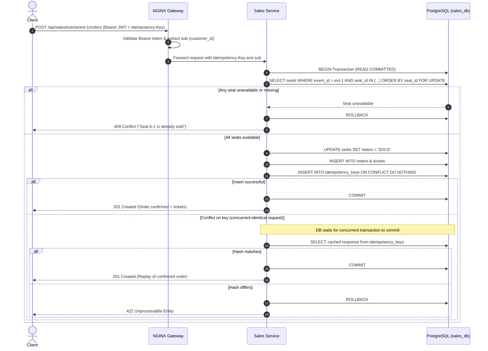

# Design

## Context

Stage I resolves the central problem of the platform before expanding into secondary features (PLAN 7.3, D-28):
preventing overselling during concurrent purchases, guaranteeing safe retries via strict customer-scoped idempotency,
delivering the customer-facing ticket purchase UI (D-28, D-32), and establishing the contract-first specification
alongside the reference hexagonal service structure (D-33). In the walking skeleton, `sales` is an empty shell
with a single `/health` endpoint. This change builds out the Core Domain in `services/sales/`, establishes the
database schema via Alembic migrations, implements PostgreSQL-backed concurrency control (D-30), provides the
contract-first specification in `services/sales/openapi.yaml` (D-24), delivers the React purchase screen, and
configures layer linting with `import-linter` (D-33).

## Goals / Non-Goals

### Goals
- Deliver the contract-first OpenAPI 3.1 specification for sales (`services/sales/openapi.yaml`, D-24).
- Enable `ADMIN` users to initialize seat inventory for events (`event_id` as an opaque reference, D-28).
- Allow authenticated clients (`CLIENT` or `ADMIN`) to query available seats for an event.
- Execute ticket purchases atomically (seats marked `SOLD` -> order confirmed -> tickets issued in one transaction, D-25).
- Prevent double-selling under high concurrency using PostgreSQL row locks ordered by seat ID (`SELECT ... FOR UPDATE ORDER BY seat_id`, D-30).
- Guarantee request idempotency scoped per customer `(customer_id, key)` persisted in the same transaction as the order (D-30).
- Handle concurrent identical requests with the same key using PostgreSQL native transaction blocking (`INSERT ... ON CONFLICT DO NOTHING` followed by committed read), returning identical `201 Created` responses without polling.
- Enforce OWASP API1 (BOLA) on order queries (`GET /orders/{order_id}` returns `404` for unauthorized customers).
- Provide a responsive React frontend screen for seat selection and checkout with shadcn/ui and Tailwind CSS (D-16, D-28, D-32).
- Establish the four-layer hexagonal architecture and Alembic migration conventions as reference, enforced by `import-linter` in CI (D-33).
- Provide automated API and contract tests with Bruno (D-24).

### Non-Goals
- Payment processing: Deferred to Stage II with `payments` as a Legacy Wrapper (D-25).
- Redis caching or distributed locks: PostgreSQL is the sole arbiter of consistency in Stage I (D-30).
- Multi-step reservations with background TTL expiration jobs: Simplified to direct atomic purchase in Stage I.
- RabbitMQ messaging: Asynchronous integration events are introduced in Stage II.
- Direct database queries to `catalog`: `sales` maintains complete autonomy over its inventory (ADR-0004).

## Decisions

### 1. Contract-first specification and CI Contract Test (D-24)
`services/sales/openapi.yaml` is the committed single source of truth for the sales API contract.
A new CI job or check named `contract-test` compares the committed `openapi.yaml` against the schema
dynamically generated by FastAPI during build/test. If an endpoint implementation drifts from the agreed
contract, `contract-test` fails the CI.
*ADR: `docs/adr/` (numbered upon merge into `main` to avoid collision with concurrent changes).*

### 2. Atomic purchase without a separate payment step (D-25)
In Stage I, the purchase operation transitions directly from seat verification to confirmed order and ticket
issuance in a single request. No payment gateway integration or payment status exists yet.
*ADR: `docs/adr/` (numbered upon merge).*

### 3. PostgreSQL as the sole arbiter of concurrency and idempotency (D-30)
Instead of introducing Redis for distributed locking (which would introduce dual-write and partial failure risks),
concurrency control is achieved using PostgreSQL transactions in `READ COMMITTED` isolation with
`SELECT ... FOR UPDATE ORDER BY seat_id` on seat rows. The idempotency record (`idempotency_keys`) uses a composite
primary key `(customer_id, key)` and is written in the exact same transaction as the order, guaranteeing atomic
idempotency tracking.
*ADR: `docs/adr/` (numbered upon merge).*

### 4. Customer-Scoped Idempotency and PostgreSQL Native Blocking
To prevent cross-customer key collision and BOLA data leaks, and handle concurrent collisions:
- The table `idempotency_keys` uses `PRIMARY KEY (customer_id, key)`.
- `request_hash` is computed from `SHA256(event_id + ":" + sorted(seat_ids))`.
- When a request arrives:
  1. `INSERT INTO idempotency_keys (customer_id, key, request_hash, response_status, response_body) VALUES (:customer_id, :key, :hash, 201, :response) ON CONFLICT (customer_id, key) DO NOTHING;`
  2. If 0 rows were inserted (another transaction holds the lock or already committed): PostgreSQL automatically
     waits on row-level lock until the in-flight transaction finishes. Once committed, a `SELECT` reads the finalized
     row. If `request_hash` matches, it returns the cached `201 Created` replay immediately. If `request_hash` differs,
     it returns `422 Unprocessable Entity`.
  3. If the in-flight transaction rolled back (e.g. `409 Conflict`), the lock is released, allowing a subsequent attempt
     to insert cleanly. Zero polling is required.

### 5. BOLA (Broken Object Level Authorization) Protection (OWASP API1)
`GET /api/sales/orders/{order_id}` verifies that the requesting user (`sub` claim) matches `customer_id` stored on
the order. If the requesting user does not own the order (and is not `ADMIN`), the endpoint returns `404 Not Found`
(not `403`), preventing existence probing of order IDs.

### 6. Reference Hexagonal Architecture and `import-linter` (D-33)
`sales` defines the four-layer hexagonal layout: `domain/`, `application/`, `infrastructure/`, and `api/`.
Layer purity is enforced by configuring `import-linter` in the `quality` CI job with a contract forbidding outward
imports from `domain/` and `application/`.

## Token-Claims Contract for Services

In accordance with the gateway perimeter security model (PR #30, D-33):
- Requests forwarded by the gateway carry a verified JWT Bearer token in the `Authorization` header.
- `sales` decodes the token payload without cryptographic signature verification (perimeter trust).
- `sub` represents the authenticated user's ID, mapped to `customer_id` in orders and idempotency keys.
- `realm_access.roles` provides user roles:
  - `ADMIN`: Authorized to call `POST /api/sales/events/{event_id}/inventory` and view any order.
  - `CLIENT`: Authorized to call `POST /api/sales/events/{event_id}/orders`, `GET /events/{event_id}/seats`, and view own orders.
- Unauthenticated requests to protected endpoints return `401 Unauthorized`; requests with inadequate roles return `403 Forbidden`.
- **Environment flag for test isolation**: An environment variable `SALES_AUTH_REQUIRED` controls authentication enforcement.
  In production and Docker Compose behind the gateway, it defaults to `true`. In unit or isolated component tests,
  it may be set to `false`, guaranteeing test convenience without risking perimeter bypass in deployed environments.

## API Contracts

Documented canonically in `services/sales/openapi.yaml`. Summary:
1. `POST /api/sales/events/{event_id}/inventory`: Requires `ADMIN`. Initializes seats with prices in ARS centavos.
2. `GET /api/sales/events/{event_id}/seats?status=AVAILABLE`: Requires authenticated `CLIENT` or `ADMIN`.
3. `POST /api/sales/events/{event_id}/orders`: Requires `CLIENT` and `Idempotency-Key` (UUIDv4). Returns `201 Created` with order and tickets.
4. `GET /api/sales/orders/{order_id}`: Requires `CLIENT` (matching owner) or `ADMIN`. Returns `200 OK` or `404 Not Found` (BOLA).

## Domain Model and Concurrency

```
+-------------------------------------------------------------------------+
|                          sales_db (PostgreSQL)                          |
|                                                                         |
| +---------------------+        +---------------------+                  |
| |        seats        |        |       orders        |                  |
| +---------------------+        +---------------------+                  |
| | event_id (PK)       |        | order_id (PK)       |                  |
| | seat_id (PK)        |        | customer_id         |                  |
| | category            |        | event_id            |                  |
| | price_centavos      |        | total_amount        |                  |
| | currency (VARCHAR)  |        | currency (VARCHAR)  |                  |
| | status (ENUM)       |        | status (ENUM)       |                  |
| +---------------------+        | created_at          |                  |
|                                +---------------------+                  |
|                                          | 1                            |
|                                          | N                            |
| +---------------------+        +---------------------+                  |
| |  idempotency_keys   |        |       tickets       |                  |
| +---------------------+        +---------------------+                  |
| | customer_id (PK)    |        | ticket_id (PK)      |                  |
| | key (PK)            |        | order_id (FK)       |                  |
| | request_hash        |        | event_id            |                  |
| | response_status     |        | seat_id             |                  |
| | response_body       |        | ticket_code         |                  |
| | created_at          |        +---------------------+                  |
| +---------------------+        CONSTRAINT uq_seat_tkt                   |
|                                UNIQUE(event_id, seat_id)                |
+-------------------------------------------------------------------------+
```

### Concurrency Flow (PostgreSQL Native Locking)
```sql
BEGIN;
SET TRANSACTION ISOLATION LEVEL READ COMMITTED;

-- 1. Validate seat_ids input (not empty, no duplicates)
-- If invalid: ROLLBACK; return 422 Unprocessable Entity.

-- 2. Lock selected seats in strict order to eliminate deadlock risk
SELECT seat_id, status, price_centavos 
FROM seats 
WHERE event_id = :event_id AND seat_id IN (:seat_ids) 
ORDER BY seat_id 
FOR UPDATE;

-- Verify count matches and status == 'AVAILABLE' for all seats
-- If any seat is not AVAILABLE or missing:
--   ROLLBACK; return 409 Conflict.

-- 3. Transition seats to SOLD
UPDATE seats SET status = 'SOLD' 
WHERE event_id = :event_id AND seat_id IN (:seat_ids);

-- 4. Create Order and Tickets
INSERT INTO orders (order_id, customer_id, event_id, total_amount, currency, status, created_at)
VALUES (:order_id, :customer_id, :event_id, :total, 'ARS', 'CONFIRMED', NOW());

INSERT INTO tickets (ticket_id, order_id, event_id, seat_id, ticket_code)
VALUES ...;

-- 5. Insert Idempotency Key with conflict handling
INSERT INTO idempotency_keys (customer_id, key, request_hash, response_status, response_body, created_at)
VALUES (:customer_id, :key, :request_hash, 201, :response_json, NOW())
ON CONFLICT (customer_id, key) DO NOTHING;

-- If inserted: COMMIT; return 201 Created.
-- If conflict (0 rows inserted):
--   A concurrent transaction is in-flight or committed.
--   PostgreSQL waits until the concurrent transaction finishes.
--   Once finished, SELECT response_status, response_body, request_hash FROM idempotency_keys WHERE customer_id = :customer_id AND key = :key;
--   If request_hash == :request_hash: COMMIT; return cached 201 response.
--   Else: ROLLBACK; return 422 Unprocessable Entity.

COMMIT;
```

## Sequence Diagrams



## Test Strategy and Organization (PLAN 5.3)

In accordance with PLAN 5.3 on test organization:
- **`services/sales/tests/unit/`**: Fast, in-memory domain tests verifying invariants and pure business logic without external IO.
- **`services/sales/tests/integration/`**: Repository, concurrency, and database persistence tests running against PostgreSQL in Docker.
- **`services/sales/tests/acceptance/`**: In-process API tests using FastAPI `TestClient`, validating HTTP status codes, Pydantic schemas, and error handling.
- **`tests/api/sales/` (System Level)**: Automated Bruno collection executed against the running Gateway per perimeter security rules (D-24).
- **System Isolation Test**: Dedicated smoke-test scenario verifying `sales` serves requests when `catalog` is down.

## Frontend Design (React + shadcn/ui)

- **Route `/events/:eventId/buy`**:
  - Displays event name and venue information.
  - Interactive seat selector grid grouping seats by category (`VIP`, `General`).
  - Seats color-coded by status: Green (Available), Grey (Sold), Blue (Selected).
  - Selected seat cart summary displaying seat IDs, category, price in ARS, and total.
  - "Confirm Purchase" button that generates a UUIDv4 `Idempotency-Key` and posts to `/api/sales/events/:eventId/orders`.
- **Route `/orders/:orderId`**:
  - Displays purchase confirmation banner, event info, total amount paid, and issued ticket cards with alphanumeric codes.
- **Mockups**: Mockup images stored in `docs/mockups/sales/` depicting seat selection and confirmation screens.

## Risks / Trade-offs

- **Row-Lock Contention on Hot Events**: Locking seats with `SELECT ... FOR UPDATE` introduces lock wait times
  if multiple users target the same seat.
  *Mitigation*: Locks are acquired strictly on specific seat rows ordered by seat ID; unrelated seats remain
  unblocked, and deadlocks are eliminated due to consistent lock ordering.
- **Table Growth of `idempotency_keys`**: High transaction volume will grow the idempotency table.
  *Mitigation*: Scoped per customer with clean indexed composite primary key `(customer_id, key)`. A retention job
  can safely purge records older than 48 hours in Stage III.
