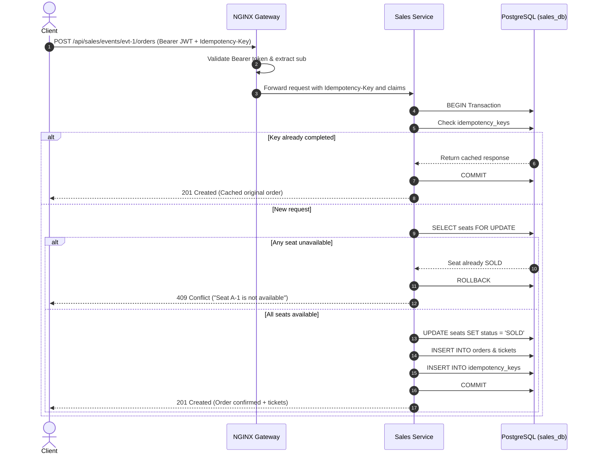

# Design

## Context

Stage I resolves the central problem of the platform before expanding into secondary features (PLAN 7.3, D-28):
preventing overselling during concurrent purchases, and guaranteeing safe retries via strict idempotency. In the
walking skeleton, `sales` is an empty shell with a single `/health` endpoint. This change builds out the Core Domain
in `services/sales/`, establishes the database schema via Alembic migrations, implements PostgreSQL-backed
concurrency control (D-30), and defines the reference hexagonal service structure (D-33) for all microservices.

## Goals / Non-Goals

### Goals
- Enable `ADMIN` users to initialize seat inventory for events (`event_id` as an opaque reference, D-28).
- Allow clients to query available seats for an event.
- Execute ticket purchases atomically (seats reserved -> order confirmed -> tickets issued in one transaction, D-25).
- Prevent double-selling under high concurrency using PostgreSQL row locks (`SELECT ... FOR UPDATE`, D-30).
- Guarantee request idempotency via `Idempotency-Key` persisted in the same transaction as the order (D-30).
- Consume the token claims contract (`sub` as client identity, `CLIENT` role) from the gateway perimeter.
- Establish the four-layer hexagonal architecture and Alembic migration conventions as reference (D-33).
- Provide automated API and contract tests with Bruno (D-24).

### Non-Goals
- Payment processing: Deferred to Stage II with `payments` as a Legacy Wrapper (D-25).
- Redis caching or distributed locks: PostgreSQL is the sole arbiter of consistency in Stage I (D-30).
- RabbitMQ messaging: Asynchronous integration events are introduced in Stage II.
- Direct database queries to `catalog`: `sales` maintains complete autonomy over its inventory (ADR-0004).

## Decisions

### 1. Atomic purchase without a separate payment step (D-25)
In Stage I, the purchase operation transitions directly from seat verification to confirmed order and ticket
issuance in a single request. No payment gateway integration or payment status exists yet.
*ADR: `docs/adr/adr-0008-pago-en-la-etapa-ii.md`.*

### 2. PostgreSQL as the sole arbiter of concurrency and idempotency (D-30)
Instead of introducing Redis for distributed locking (which would introduce dual-write and partial failure risks),
concurrency control is achieved using PostgreSQL transactions with `SELECT ... FOR UPDATE` on seat rows. The
idempotency record (`idempotency_keys`) is written in the exact same transaction as the order, guaranteeing that
idempotency tracking is atomic with business state.
*ADR: `docs/adr/adr-0009-concurrencia-e-idempotencia-postgresql.md`.*

### 3. Reference Hexagonal Service Architecture (D-33)
`sales` defines the four-layer hexagonal layout that `catalog` and `payments` will adopt:
`domain/` (pure Python entities and rules), `application/` (use cases and ports), `infrastructure/` (SQLAlchemy
adapters and Alembic migrations), and `api/` (FastAPI controllers and Pydantic schemas).
*Rules recorded in `AGENTS.md`.*

### 4. API and Contract Testing with Bruno (D-24)
A Bruno collection in `tests/api/sales/` validates the HTTP endpoints against the gateway.
*ADR: `docs/adr/adr-0010-tests-de-api-y-contrato.md`.*

## Token-Claims Contract for Services

In accordance with the gateway perimeter security model (PR #30, D-33):
- Requests forwarded by the gateway carry a verified JWT Bearer token in the `Authorization` header.
- `sales` decodes the token payload without cryptographic signature verification (perimeter trust).
- `sub` represents the authenticated user's ID, mapped to `customer_id` in orders.
- `realm_access.roles` provides user roles:
  - `ADMIN`: Authorized to call `POST /api/sales/events/{event_id}/inventory`.
  - `CLIENT`: Authorized to call `POST /api/sales/events/{event_id}/orders` and `GET /api/sales/orders/{order_id}`.
- Early development and unit/integration tests support optional authentication, enabling isolated test runs.

## API Contracts

### 1. `POST /api/sales/events/{event_id}/inventory`
- **Auth**: Requires `ADMIN` role.
- **Request Body**:
  ```json
  {
    "seats": [
      {"seat_id": "A-1", "category": "VIP", "price": 15000},
      {"seat_id": "A-2", "category": "VIP", "price": 15000}
    ]
  }
  ```
- **Responses**:
  - `201 Created`: Inventory initialized successfully.
  - `409 Conflict`: Event inventory already initialized.
  - `422 Unprocessable Entity`: Invalid seat data or negative prices.

### 2. `GET /api/sales/events/{event_id}/seats?status=AVAILABLE`
- **Auth**: Public or `CLIENT`.
- **Response**:
  - `200 OK`:
    ```json
    [
      {"seat_id": "A-1", "category": "VIP", "price": 15000, "status": "AVAILABLE"}
    ]
    ```

### 3. `POST /api/sales/events/{event_id}/orders`
- **Auth**: Requires `CLIENT` role.
- **Headers**: `Idempotency-Key: <UUIDv4>` (Mandatory).
- **Request Body**:
  ```json
  {
    "seat_ids": ["A-1", "A-2"]
  }
  ```
- **Responses**:
  - `201 Created`: Order confirmed and tickets issued.
    ```json
    {
      "order_id": "ord-8f7a1b",
      "event_id": "evt-100",
      "customer_id": "usr-client-1",
      "total_amount": 30000,
      "status": "CONFIRMED",
      "tickets": [
        {"ticket_id": "tkt-1", "seat_id": "A-1", "code": "GOPASS-A1-8F7A"},
        {"ticket_id": "tkt-2", "seat_id": "A-2", "code": "GOPASS-A2-8F7A"}
      ],
      "created_at": "2026-11-19T20:00:00Z"
    }
    ```
  - `400 Bad Request`: Missing or invalid `Idempotency-Key`.
  - `409 Conflict`: One or more requested seats are not available.
  - `422 Unprocessable Entity`: Idempotency key reused with mismatched request payload.

### 4. `GET /api/sales/orders/{order_id}`
- **Auth**: Requires `CLIENT` (matching order's `customer_id`) or `ADMIN`.
- **Responses**:
  - `200 OK`: Order details with tickets.
  - `404 Not Found`: Order not found.

## Domain Model and Concurrency

```
+-------------------------------------------------------------------+
|                        sales_db (PostgreSQL)                      |
|                                                                   |
| +-------------------+      +-------------------+                  |
| |       seats       |      |      orders       |                  |
| +-------------------+      +-------------------+                  |
| | event_id (PK)     |      | order_id (PK)     |                  |
| | seat_id (PK)      |      | customer_id       |                  |
| | category          |      | event_id          |                  |
| | price             |      | total_amount      |                  |
| | status (ENUM)     |      | status (ENUM)     |                  |
| +-------------------+      | created_at        |                  |
|                            +-------------------+                  |
|                                      | 1                          |
|                                      | N                          |
| +-------------------+      +-------------------+                  |
| | idempotency_keys  |      |      tickets      |                  |
| +-------------------+      +-------------------+                  |
| | key (PK)          |      | ticket_id (PK)    |                  |
| | customer_id       |      | order_id (FK)     |                  |
| | request_hash      |      | seat_id           |                  |
| | response_status   |      | ticket_code       |                  |
| | response_body     |      +-------------------+                  |
| | created_at        |                                             |
| +-------------------+                                             |
+-------------------------------------------------------------------+
```

### Concurrency Flow (Pseudo-SQL Transaction)
```sql
BEGIN;

-- 1. Check idempotency key
SELECT response_status, response_body, request_hash 
FROM idempotency_keys 
WHERE key = :idempotency_key FOR UPDATE;

-- If key exists and hash matches:
--   COMMIT; return cached response immediately.
-- If key exists and hash differs:
--   ROLLBACK; return 422 Unprocessable Entity.

-- 2. Lock selected seats
SELECT seat_id, status, price 
FROM seats 
WHERE event_id = :event_id AND seat_id IN (:seat_ids) 
FOR UPDATE;

-- Verify all seats exist and status == 'AVAILABLE'
-- If any seat is not AVAILABLE:
--   ROLLBACK; return 409 Conflict.

-- 3. Transition seats to SOLD
UPDATE seats SET status = 'SOLD' 
WHERE event_id = :event_id AND seat_id IN (:seat_ids);

-- 4. Create Order and Tickets
INSERT INTO orders (order_id, customer_id, event_id, total_amount, status, created_at)
VALUES (:order_id, :customer_id, :event_id, :total, 'CONFIRMED', NOW());

INSERT INTO tickets (ticket_id, order_id, seat_id, ticket_code)
VALUES ...;

-- 5. Record Idempotency Key
INSERT INTO idempotency_keys (key, customer_id, request_hash, response_status, response_body, created_at)
VALUES (:idempotency_key, :customer_id, :hash, 201, :response_json, NOW());

COMMIT;
```

## Sequence Diagrams



## Test Strategy

1. **Unit Tests (Domain)**:
   - Invariants of `Seat`, `Order`, and `Ticket`.
   - `Money` value object calculations.
   - 100% pure Python, zero IO, executes in milliseconds.
2. **Integration Tests (Infrastructure & Persistence)**:
   - SQLAlchemy repository implementations against real PostgreSQL in Docker.
   - Verifying row-locking behavior and rollback on constraint violation.
   - Alembic migration upgrade/downgrade validation.
3. **API Tests (FastAPI)**:
   - `TestClient` executing end-to-end request cycles.
   - Idempotency replay and mismatch detection.
   - Missing headers and validation errors.
4. **Bruno Collection (D-24)**:
   - `tests/api/sales/`: Automated collection verifying endpoints through the Gateway.

## Risks / Trade-offs

- **Row-Lock Contention on Hot Events**: Locking seats with `SELECT ... FOR UPDATE` introduces lock wait times
  if thousands of users target the same exact seat.
  *Mitigation*: Locks are acquired strictly on specific seat rows for milliseconds; unrelated seats remain
  completely unblocked.
- **Table Growth of `idempotency_keys`**: High transaction volume will grow the idempotency table.
  *Mitigation*: In Stage III, a scheduled retention job will purge records older than 24–48 hours.
- **Rollback on Error**: If a transaction fails midway, PostgreSQL automatically releases row locks and rolls
  back changes, preventing orphaned reservations.
