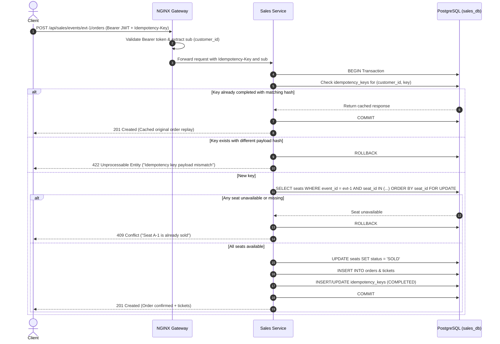

# Design

## Context

Stage I resolves the central problem of the platform before expanding into secondary features (PLAN 7.3, D-28):
preventing overselling during concurrent purchases, guaranteeing safe retries via strict customer-scoped idempotency,
and delivering the customer-facing ticket purchase UI (D-28, D-32). In the walking skeleton, `sales` is an empty
shell with a single `/health` endpoint. This change builds out the Core Domain in `services/sales/`, establishes the
database schema via Alembic migrations, implements PostgreSQL-backed concurrency control (D-30), provides the
React purchase screen, and defines the reference hexagonal service structure (D-33) for all microservices.

## Goals / Non-Goals

### Goals
- Enable `ADMIN` users to initialize seat inventory for events (`event_id` as an opaque reference, D-28).
- Allow clients to query available seats for an event.
- Execute ticket purchases atomically (seats marked `SOLD` -> order confirmed -> tickets issued in one transaction, D-25).
- Prevent double-selling under high concurrency using PostgreSQL row locks ordered by seat ID (`SELECT ... FOR UPDATE ORDER BY seat_id`, D-30).
- Guarantee request idempotency scoped per customer `(customer_id, key)` persisted in the same transaction as the order (D-30).
- Handle concurrent identical requests with the same key via `INSERT ... ON CONFLICT` or transaction serialization, returning identical `201 Created` responses.
- Enforce OWASP API1 (BOLA) on order queries (`GET /orders/{order_id}` returns `404` for unauthorized customers).
- Provide a responsive React frontend screen for seat selection and checkout with shadcn/ui and Tailwind CSS (D-16, D-28, D-32).
- Establish the four-layer hexagonal architecture and Alembic migration conventions as reference (D-33).
- Provide automated API and contract tests with Bruno (D-24).

### Non-Goals
- Payment processing: Deferred to Stage II with `payments` as a Legacy Wrapper (D-25).
- Redis caching or distributed locks: PostgreSQL is the sole arbiter of consistency in Stage I (D-30).
- Multi-step reservations with background TTL expiration jobs: Simplified to direct atomic purchase in Stage I.
- RabbitMQ messaging: Asynchronous integration events are introduced in Stage II.
- Direct database queries to `catalog`: `sales` maintains complete autonomy over its inventory (ADR-0004).

## Decisions

### 1. Atomic purchase without a separate payment step (D-25)
In Stage I, the purchase operation transitions directly from seat verification to confirmed order and ticket
issuance in a single request. No payment gateway integration or payment status exists yet.
*ADR: `docs/adr/adr-0008-pago-en-la-etapa-ii.md`.*

### 2. PostgreSQL as the sole arbiter of concurrency and idempotency (D-30)
Instead of introducing Redis for distributed locking (which would introduce dual-write and partial failure risks),
concurrency control is achieved using PostgreSQL transactions with `SELECT ... FOR UPDATE ORDER BY seat_id` on seat
rows. The idempotency record (`idempotency_keys`) uses a composite primary key `(customer_id, key)` and is written
in the exact same transaction as the order, guaranteeing atomic idempotency tracking.
*ADR: `docs/adr/adr-0009-concurrencia-e-idempotencia-postgresql.md`.*

### 3. Customer-Scoped Idempotency and Concurrent Collision Handling
To prevent cross-customer key collision and BOLA data leaks:
- The table `idempotency_keys` uses `PRIMARY KEY (customer_id, key)`.
- Initial key reservation uses an atomic `INSERT INTO idempotency_keys (customer_id, key, status, request_hash) VALUES (:customer_id, :key, 'IN_PROGRESS', :hash) ON CONFLICT (customer_id, key) DO NOTHING;` or catches primary key violation.
- If a duplicate request arrives while a previous one is `IN_PROGRESS`, it polls briefly or yields until the first completes, returning the identical `201 Created` response.
- Reusing an existing key with a mismatched request payload produces a clean `422 Unprocessable Entity`.

### 4. BOLA (Broken Object Level Authorization) Protection (OWASP API1)
`GET /api/sales/orders/{order_id}` verifies that the requesting user (`sub` claim) matches `customer_id` stored on
the order. If the requesting user does not own the order (and is not `ADMIN`), the endpoint returns `404 Not Found`
(not `403`), preventing existence probing of order IDs.

### 5. Reference Hexagonal Service Architecture (D-33)
`sales` defines the four-layer hexagonal layout that `catalog` and `payments` will adopt:
`domain/` (pure Python entities and rules), `application/` (use cases and ports), `infrastructure/` (SQLAlchemy
adapters and Alembic migrations), and `api/` (FastAPI controllers and Pydantic schemas).
*Rules recorded in `AGENTS.md`.*

### 6. API and Contract Testing with Bruno (D-24)
A Bruno collection in `tests/api/sales/` validates the HTTP endpoints against the gateway.
*ADR: `docs/adr/adr-0010-tests-de-api-y-contrato.md`.*

## Token-Claims Contract for Services

In accordance with the gateway perimeter security model (PR #30, D-33):
- Requests forwarded by the gateway carry a verified JWT Bearer token in the `Authorization` header.
- `sales` decodes the token payload without cryptographic signature verification (perimeter trust).
- `sub` represents the authenticated user's ID, mapped to `customer_id` in orders and idempotency keys.
- `realm_access.roles` provides user roles:
  - `ADMIN`: Authorized to call `POST /api/sales/events/{event_id}/inventory` and view any order.
  - `CLIENT`: Authorized to call `POST /api/sales/events/{event_id}/orders` and view own orders.
- Unauthenticated requests to protected endpoints return `401 Unauthorized`; requests with inadequate roles return `403 Forbidden`.
- Early local unit and integration tests support optional authentication, enabling isolated test execution.

## API Contracts

### 1. `POST /api/sales/events/{event_id}/inventory`
- **Auth**: Requires `ADMIN` role.
- **Request Body**:
  ```json
  {
    "seats": [
      {"seat_id": "A-1", "category": "VIP", "price_centavos": 1500000},
      {"seat_id": "A-2", "category": "VIP", "price_centavos": 1500000}
    ]
  }
  ```
- **Responses**:
  - `201 Created`: Inventory initialized successfully.
  - `401 Unauthorized`: Missing or invalid bearer token.
  - `403 Forbidden`: User lacks `ADMIN` role.
  - `409 Conflict`: Event inventory already initialized.
  - `422 Unprocessable Entity`: Invalid seat data, empty seat list, or negative prices.

### 2. `GET /api/sales/events/{event_id}/seats?status=AVAILABLE`
- **Auth**: Public or authenticated.
- **Response**:
  - `200 OK`:
    ```json
    [
      {"seat_id": "A-1", "category": "VIP", "price_centavos": 1500000, "status": "AVAILABLE"}
    ]
    ```

### 3. `POST /api/sales/events/{event_id}/orders`
- **Auth**: Requires `CLIENT` role.
- **Headers**: `Idempotency-Key: <UUIDv4>` (Mandatory).
- **Request Body**:
  ```json
  {
    "seat_ids": ["A-1", "A-2"]
  }
  ```
- **Responses**:
  - `201 Created`: Order confirmed and tickets issued.
    ```json
    {
      "order_id": "ord-8f7a1b",
      "event_id": "evt-100",
      "customer_id": "usr-client-1",
      "total_amount_centavos": 3000000,
      "currency": "ARS",
      "status": "CONFIRMED",
      "tickets": [
        {"ticket_id": "tkt-1", "seat_id": "A-1", "code": "GOPASS-A1-8F7A"},
        {"ticket_id": "tkt-2", "seat_id": "A-2", "code": "GOPASS-A2-8F7A"}
      ],
      "created_at": "2026-11-20T12:00:00Z"
    }
    ```
  - `400 Bad Request`: Missing or invalid `Idempotency-Key` format.
  - `401 Unauthorized`: Missing authentication.
  - `403 Forbidden`: User lacks `CLIENT` role.
  - `409 Conflict`: One or more requested seats are not available.
  - `422 Unprocessable Entity`: Idempotency key reused with mismatched payload, empty seat list, or duplicate seat IDs.

### 4. `GET /api/sales/orders/{order_id}`
- **Auth**: Requires `CLIENT` (matching order's `customer_id`) or `ADMIN`.
- **Responses**:
  - `200 OK`: Order details with tickets.
  - `401 Unauthorized`: Missing authentication.
  - `404 Not Found`: Order not found, or belongs to another customer (BOLA).

## Domain Model and Concurrency

```
+-------------------------------------------------------------------------+
|                          sales_db (PostgreSQL)                          |
|                                                                         |
| +---------------------+        +---------------------+                  |
| |        seats        |        |       orders        |                  |
| +---------------------+        +---------------------+                  |
| | event_id (PK)       |        | order_id (PK)       |                  |
| | seat_id (PK)        |        | customer_id         |                  |
| | category            |        | event_id            |                  |
| | price_centavos      |        | total_amount        |                  |
| | currency (VARCHAR)  |        | currency (VARCHAR)  |                  |
| | status (ENUM)       |        | status (ENUM)       |                  |
| +---------------------+        | created_at          |                  |
|                                +---------------------+                  |
|                                          | 1                            |
|                                          | N                            |
| +---------------------+        +---------------------+                  |
| |  idempotency_keys   |        |       tickets       |                  |
| +---------------------+        +---------------------+                  |
| | customer_id (PK)    |        | ticket_id (PK)      |                  |
| | key (PK)            |        | order_id (FK)       |                  |
| | request_hash        |        | event_id            |                  |
| | response_status     |        | seat_id             |                  |
| | response_body       |        | ticket_code         |                  |
| | status (ENUM)       |        +---------------------+                  |
| | created_at          |        CONSTRAINT uq_seat_tkt                   |
| +---------------------+        UNIQUE(event_id, seat_id)                |
+-------------------------------------------------------------------------+
```

### Concurrency Flow (PostgreSQL Row-Locking with Ordered Seats)
```sql
BEGIN;

-- 1. Check or reserve customer-scoped idempotency key
SELECT response_status, response_body, request_hash, status 
FROM idempotency_keys 
WHERE customer_id = :customer_id AND key = :key FOR UPDATE;

-- If key exists with COMPLETED and request_hash matches:
--   COMMIT; return cached response immediately (201 Created).
-- If key exists with mismatched request_hash:
--   ROLLBACK; return 422 Unprocessable Entity.
-- If key does not exist:
--   INSERT INTO idempotency_keys (customer_id, key, request_hash, status, created_at)
--   VALUES (:customer_id, :key, :hash, 'IN_PROGRESS', NOW());

-- 2. Validate seat_ids input (not empty, no duplicates)
-- If empty or duplicates: ROLLBACK; return 422 Unprocessable Entity.

-- 3. Lock selected seats in strict order to eliminate deadlock risk
SELECT seat_id, status, price_centavos 
FROM seats 
WHERE event_id = :event_id AND seat_id IN (:seat_ids) 
ORDER BY seat_id 
FOR UPDATE;

-- Verify count matches and status == 'AVAILABLE' for all seats
-- If any seat is not AVAILABLE or missing:
--   ROLLBACK; return 409 Conflict.

-- 4. Transition seats to SOLD
UPDATE seats SET status = 'SOLD' 
WHERE event_id = :event_id AND seat_id IN (:seat_ids);

-- 5. Create Order and Tickets
INSERT INTO orders (order_id, customer_id, event_id, total_amount, currency, status, created_at)
VALUES (:order_id, :customer_id, :event_id, :total, 'ARS', 'CONFIRMED', NOW());

INSERT INTO tickets (ticket_id, order_id, event_id, seat_id, ticket_code)
VALUES ...;

-- 6. Mark idempotency key COMPLETED and store response JSON
UPDATE idempotency_keys 
SET response_status = 201, response_body = :response_json, status = 'COMPLETED' 
WHERE customer_id = :customer_id AND key = :key;

COMMIT;
```

## Sequence Diagrams



## Frontend Design (React + shadcn/ui)

- **Route `/events/:eventId/buy`**:
  - Displays event name and venue information.
  - Interactive seat selector grid grouping seats by category (`VIP`, `General`).
  - Seats color-coded by status: Green (Available), Grey (Sold), Blue (Selected).
  - Selected seat cart summary displaying seat IDs, category, price in ARS, and total.
  - "Confirm Purchase" button that generates a UUIDv4 `Idempotency-Key` and posts to `/api/sales/events/:eventId/orders`.
  - Disables button and displays loading spinner during in-flight submission.
- **Route `/orders/:orderId`**:
  - Displays purchase confirmation banner, event info, total amount paid, and issued ticket cards with QR/alphanumeric codes.
  - Accessible from confirmation redirect or customer account order history.

## Test Strategy

1. **Unit Tests (Domain)**:
   - Invariants of `Seat`, `Order`, `Ticket`, and `Money`.
   - Architectural import test verifying `domain/` contains zero external dependencies.
2. **Integration Tests (Infrastructure & Persistence)**:
   - SQLAlchemy repository implementations against real PostgreSQL in Docker.
   - Verifying `SELECT ... FOR UPDATE ORDER BY seat_id` deadlock prevention and concurrency.
   - Composite key `(customer_id, key)` isolation across customers.
   - Simultaneous request race with identical key yielding a single order.
   - Alembic migration upgrade/downgrade validation.
3. **API Tests (FastAPI)**:
   - `TestClient` executing end-to-end request cycles.
   - Role enforcement (`401` unauthenticated, `403` role forbidden).
   - BOLA verification (`404` when client accesses another customer's order).
   - Validation failures (`422` on empty or duplicate seat lists, `422` on idempotency mismatch).
4. **Bruno Collection (D-24)**:
   - `tests/api/sales/`: Automated collection verifying endpoints through the Gateway.
5. **Frontend Tests (Vitest + React Testing Library)**:
   - Unit tests of seat selection grid, cart summary, and purchase button disable state.
   - Integration tests mocking API purchase responses and testing confirmation redirect.

## Risks / Trade-offs

- **Row-Lock Contention on Hot Events**: Locking seats with `SELECT ... FOR UPDATE` introduces lock wait times
  if multiple users target the same seat.
  *Mitigation*: Locks are acquired strictly on specific seat rows ordered by seat ID; unrelated seats remain
  unblocked, and deadlocks are impossible due to consistent lock ordering.
- **Table Growth of `idempotency_keys`**: High transaction volume will grow the idempotency table.
  *Mitigation*: Scoped per customer with clean indexed primary key `(customer_id, key)`. A retention job can
  safely purge records older than 48 hours in Stage III.
