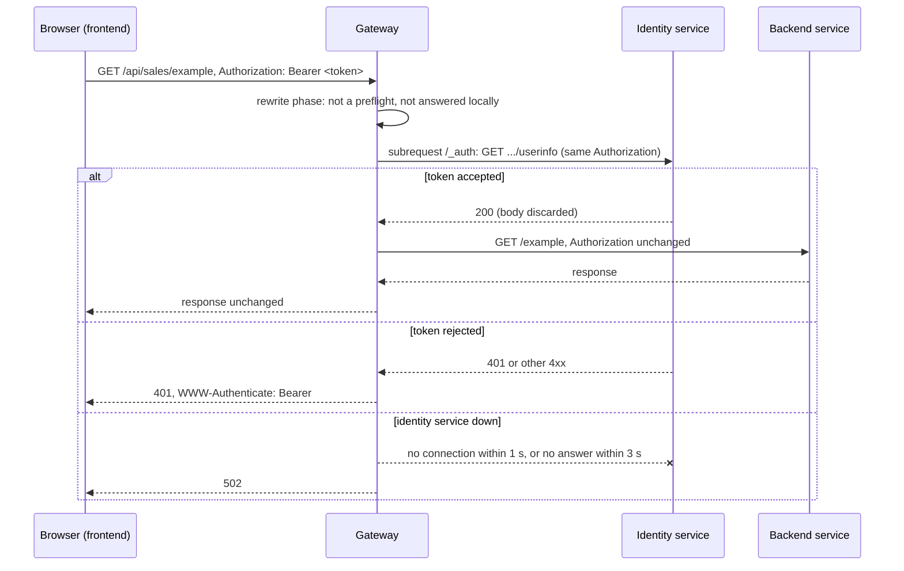
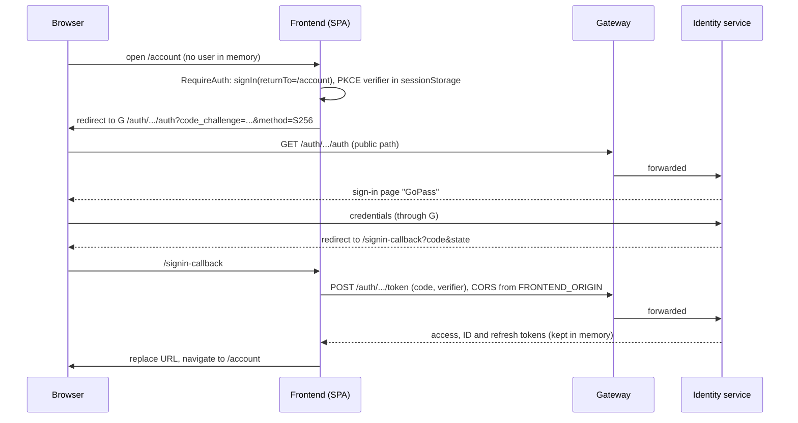

# Design

## Context

See `proposal.md` (Why, What Changes) for motivation and scope, and the four specs under `specs/` for the required
behavior. This document explains how the gateway, the realm, the frontend and the tests implement them.

Current state that shapes the approach:

- The gateway (`infra/gateway/templates/default.conf.template`) forwards every route without checking identity.
  Route files live in `infra/gateway/routes/` and are included inside the server block, so a server-level
  directive reaches every route, those added later included. Test-only routes live in `tests/smoke/gateway/` and
  are mounted only by `tests/smoke/compose.echo.yml`.
- NGINX resolves each upstream once, at startup (DS-07), and the gateway already waits for the identity service
  to be healthy. A stopped container therefore leaves an address with nothing behind it: connections time out
  instead of being refused.
- The catalog, sales and payments route files each set `proxy_connect_timeout 3s` and their own
  `error_page 504 =502`. A location with its own `error_page` inherits none from the server.
- The identity service runs Keycloak 26.8 in development mode. `KC_HOSTNAME` is a full URL, so the issuer is
  `http://localhost:<GATEWAY_PORT>/auth/realms/ticketera` whatever host name the request uses. `KC_PROXY_HEADERS`
  is not set.
- The realm definition has only the three platform roles. Keycloak creates its built-in clients and default client
  scopes on import; `basic` and `roles` put `sub` and `realm_access.roles` in the access token.
- The realm secret check (`scripts/check_realm_secrets.py`, DS-20) treats any object under `credentials` as a
  literal, so a `${VAR}` password placeholder fails today.
- The frontend (PR #20) is one status page with no router, no OIDC library and no Tailwind CSS.
- Runtime checks made during exploration: the gateway image has the `auth_request` module; NGINX answers `400` to a
  duplicated `Authorization` header; `userinfo` answers `401` to a missing or malformed token; the image's
  `main` log format writes `$request`, query string included; Keycloak answers CORS on the discovery document for
  the frontend's origin; `admin-cli` of the `ticketera` realm allows the password grant.
- `openspec/specs/` is empty: the platform specs this change modifies exist only in the unarchived
  `project-bootstrap` change, so this change is archived after it.

## Goals / Non-Goals

**Goals:**

- Authenticate every forwarded request at one point, the gateway, so a route added later is protected without
  declaring anything (secure by default).
- Keep revocation immediate: a token stops working as soon as its session ends.
- Keep the identity service a dependency of protected routes only: health, the gateway's own answers and the
  status page keep working while it is down.
- Give the feature changes a stable token-claims contract they can copy into their specs and implement in the
  D-33 skeleton.
- Keep tokens out of URLs, logs and persistent browser storage.

**Non-Goals:**

- Authorization by role at the gateway, signature checks in services and caching of `userinfo` answers (see
  proposal, Non-goals). The design keeps each one possible later without changing the specs.
- A browser end-to-end test tool: the scenarios that need a real browser are checked by hand and recorded as
  evidence (see Test Strategy).
- The final gateway log format, which `e1-request-log` owns; this change only sets the rule it must keep.

## Decisions

The Trace column links every D-xx that has an architecture decision record (D-27). IA-xx numbers are local to this
change; DS-xx are the decisions of `project-bootstrap`.

| # | Decision | Trace | Alternatives considered (reason rejected) |
| --- | --- | --- | --- |
| IA-01 | Token validation at the gateway with `auth_request` to an internal location that calls the identity service's `userinfo` endpoint; services trust the forwarded token | D-03 [ADR-0002][adr-0002], D-04 [ADR-0003][adr-0003], [ADR-0007][adr-0007] | njs JWT check, OpenResty, introspection, JWKS check in each service, NGINX Plus `auth_jwt`, caching (see Alternatives Considered) |
| IA-02 | `auth_request` set once at server level; `/auth/` opts out with `auth_request off` | D-04 [ADR-0003][adr-0003] | `auth_request` in each route file (a new route without it would be open) |
| IA-03 | Public health check inside the auth location, on the method and the raw request URI with a strict pattern | — | Map on `$uri` (in the subrequest it is `/_auth`); per-path `location` blocks for health (need variable `proxy_pass`, rejected by DS-07) |
| IA-04 | Local `401` without a `Bearer <token>` header; every `userinfo` 4xx mapped to `401`; every failure to reach it mapped to `502` | — | Passing the identity service's status through (`403 insufficient_scope` would look like a role denial) |
| IA-05 | Identity timeouts: connect 1 s, read 3 s, for the auth location and for `/auth/` | DS-15 | Connect 3 s and read 5 s from the exploration (up to 8 s, breaks the 5-second limit) |
| IA-06 | `proxy_connect_timeout 3s` and `error_page 500 502 504 =502 @upstream_unavailable` move to server level and leave the route files | DS-07, DS-15 | Keep them per route (each new route must remember them, and the auth failure answers `500` in routes that declare their own `error_page`) |
| IA-07 | Preflight answer adds `Access-Control-Allow-Methods` and `Access-Control-Allow-Headers` through maps, sent only on preflights | DS-09 | Static headers on every response (noise on every API answer) |
| IA-08 | Gateway log format without query string or referrer; gateway error log at level `crit` | — | Keep `main` (logs `id_token_hint` and query tokens); reject token-like query parameters (incomplete: any name can carry one) |
| IA-09 | `KC_PROXY_HEADERS=xforwarded`; the auth location includes the forwarding snippet too | DS-08 | `KC_PROXY_TRUSTED_ADDRESSES` with the backend subnet (Compose assigns it dynamically) |
| IA-10 | Realm clients: public `ticketera-frontend` (code flow, PKCE `S256`, exact redirect URIs from `FRONTEND_ORIGIN`), public `ticketera-api-tests` (password grant only), `admin-cli` redefined without direct grants | D-03 [ADR-0002][adr-0002] | Confidential clients (a secret in the repository or in every member's `.env`); services checking `azp` instead of disabling `admin-cli` grants (one more rule in every service) |
| IA-11 | Test users with complete profiles and `${TEST_USER_<ROLE>_PASSWORD}` placeholders; realm `${FRONTEND_ORIGIN}` placeholders | DS-05, DS-16 | Users created by a script after startup (state outside the realm definition; `down -v` would need a second step) |
| IA-12 | Realm secret check reads credential objects field by field | DS-20 | Removing `credentials` from the secret keys (lets exported password hashes through) |
| IA-13 | Frontend OIDC with `oidc-client-ts` and a small own `AuthProvider`; routing with React Router in declarative mode | D-01, D-16 | `keycloak-js`, `react-oidc-context`, own PKCE code; TanStack Router, wouter (see Alternatives Considered) |
| IA-14 | Tokens kept in memory; renewal with the refresh token; page reload restored by a silent sign-in in a hidden frame | — | `sessionStorage` (default of the library) or `localStorage` (readable by any injected script) |
| IA-15 | Sign-out by a form `POST` to the end-session endpoint with `id_token_hint` in the body | — | `GET` with `id_token_hint` (token in the URL and the gateway log); `GET` without it (Keycloak shows a confirmation page) |
| IA-16 | GoPass base (Tailwind CSS 4, shadcn/ui, D-38 tokens) as its own task group, the first of the frontend pull request | D-16, D-38 | Mixing it with the authentication work (C reviews styling and authentication in the same commits) |
| IA-17 | Identity checks in a new `tests/smoke/identity-checks.sh` sourced by the smoke test; a test-only route `/api/smoke-latency/` in `tests/smoke/gateway/` | DS-19, RB-09 | Growing `smoke-test.sh` by several hundred lines; the latency route in the shipped configuration (an open test route in every environment) |
| IA-18 | `ticketera-api-tests` access tokens last 60 s, so the smoke test can check an expired token | — | A dedicated short-lived test client (one more client); changing lifespans through the admin API during the test (state to restore) |
| IA-19 | Bruno collection `tests/api/identity/` run locally from a pinned Node container with `npm ci` and a lockfile in `tests/api/` | D-24, DS-25 | `npx @usebruno/cli@<version>` (installs outside a lockfile) |

[adr-0002]: /docs/adr/adr-0002-identidad-keycloak.md
[adr-0003]: /docs/adr/adr-0003-api-gateway-nginx.md
[adr-0005]: /docs/adr/adr-0005-arquitectura-hexagonal.md
[adr-0007]: /docs/adr/adr-0007-validacion-de-tokens-en-el-gateway.md

ADR-0007 (token validation at the gateway with `auth_request` and `userinfo`) does not exist yet: a task of this
change writes it with the `create-architectural-decision-record` skill (D-27). Its number and slug are fixed when
it is written, and this link is updated if they change.

### Decision notes: gateway

- **Auth location (IA-01, IA-02).** The server block gets `auth_request /_auth;`. `location = /_auth` is
  `internal`, passes no body (`proxy_pass_request_body off`, `Content-Length ""`), uses `GET`, clears
  `Content-Type` and `Cookie`, includes `snippets/forwarded-headers.conf` (IA-09) and calls
  `http://identity:8080/auth/realms/ticketera/protocol/openid-connect/userinfo` by the internal name, which works
  because the issuer is fixed by `KC_HOSTNAME`. The client's `Authorization` header reaches the subrequest
  unchanged; the service later receives it unchanged too. The `userinfo` body never reaches the client:
  `auth_request` reads only the status.
- **Requests the gateway answers itself.** `/healthz`, the `404` fallback, the `/auth/health` and `/auth/metrics`
  blocks and the preflight all finish in the rewrite phase with `return`, before the access phase where
  `auth_request` runs, so they keep their bootstrap answers without a token. The `421` default server has no
  `auth_request`.
- **Public paths (IA-03).** Inside the subrequest, `$uri` is `/_auth`, so the check cannot use it. It uses two
  values the subrequest shares with the main request: `$request_method` (always the main request's) and
  `$request_uri` (the raw URI, copied to the subrequest). A map marks as public only
  `~^(GET|HEAD):/api/[a-z0-9-]+/health(\?.*)?$`, and the auth location answers `204` for it without calling the
  identity service. The pattern allows no dot, percent sign or empty segment, so whenever the raw URI matches,
  the normalized path NGINX routes on is the same health path; any other spelling stays protected. `/auth/` is
  public through `auth_request off` in its `location`, which NGINX chooses on the normalized URI, so a raw
  `/auth/../api/sales/example` lands in the sales route and is checked. The `POST /api/sales/health` scenario
  proves that `$request_method` is the main request's.
- **Answers (IA-04).** The auth location answers `401` itself, with `WWW-Authenticate: Bearer`, when
  `$http_authorization` does not match a case-insensitive `Bearer` followed by an RFC 6750 token. It sets
  `proxy_intercept_errors on` and maps every 4xx of `userinfo` to a named location that answers `401` with the
  same challenge, so `auth_request` only ever sees `2xx` or `401` from a reachable identity service. A connection
  timeout or a `5xx` reaches `auth_request` as an unexpected status, which it turns into `500`; the server-level
  `error_page` (IA-06) turns that into `502`. A request that carries two `Authorization` headers is rejected with
  `400` by NGINX itself before any of this runs.
- **Timeouts (IA-05).** Connect 1 s and read 3 s, in `/_auth` and in `/auth/`. A stopped identity service answers
  `502` after about 1 s; a hung one after about 3 s; the worst case is under 4 s, inside the 5-second limit with
  margin for slow CI runners. The 1-second connect timeout is safe because the connection is between containers
  on the same network.
- **Failure mapping (IA-06).** The template gets `proxy_connect_timeout 3s;`,
  `error_page 500 502 504 =502 @upstream_unavailable;` and `location @upstream_unavailable { return 502; }` at
  server level. The connect timeout and `error_page` lines, and the `@catalog_unavailable`, `@sales_unavailable`
  and `@payments_unavailable` locations, leave `catalog.conf`, `sales.conf` and `payments.conf`. That closes the
  pending item of the group 3 team log. A route that keeps its own `error_page` would answer `500` when the
  identity service is down; the smoke test covers it.
- **Preflight (IA-07).** Two maps keyed on `$is_api_preflight` give `Access-Control-Allow-Methods: GET, HEAD,
  POST, PUT, PATCH, DELETE` and `Access-Control-Allow-Headers: Authorization, Content-Type, Idempotency-Key` on
  preflights and an empty value otherwise; NGINX sends no header whose value is empty. They are added with
  `add_header ... always` next to the existing CORS headers, so a `401` also carries
  `Access-Control-Allow-Origin` for the frontend's origin. Route files keep using no `add_header`.
- **Logs (IA-08).** The template defines `log_format ticketera` with `$request_method $uri $server_protocol`
  instead of `$request`, and without `$http_referer`; the server uses it for `access_log`. No variable carrying a
  header value or the query string is logged. NGINX error log lines always include the full request line, query
  string included, and the referrer, so the server sets `error_log ... crit`. Upstream failures still show in the
  access log as `502`. `e1-request-log` (B) owns the final format and adds the correlation id; it must keep this
  rule: no `$request`, `$args`, `$query_string`, `$request_uri`, `$http_authorization` or `$http_referer`.
- **Client address (IA-09).** `KC_PROXY_HEADERS=xforwarded` makes Keycloak use `X-Forwarded-For`. That is safe
  because only the gateway reaches Keycloak (backend network) and the gateway replaces those headers (DS-08).
  Including the forwarding snippet in `/_auth` keeps a forged `X-Forwarded-For` out of the subrequest too.
  `KC_HOSTNAME` stays a full URL, so `X-Forwarded-Host` cannot change the issuer.

### Decision notes: realm and identity service

- **Frontend client (IA-10).** `ticketera-frontend`: `publicClient`, `standardFlowEnabled`, no implicit flow, no
  direct access grants, no service account; attributes `pkce.code.challenge.method=S256`,
  `client.use.lightweight.access.token.enabled=false` and
  `post.logout.redirect.uris=${FRONTEND_ORIGIN}/`. Exact `redirectUris`: `${FRONTEND_ORIGIN}/signin-callback` and
  `${FRONTEND_ORIGIN}/silent-callback`; `webOrigins`: `${FRONTEND_ORIGIN}`. A client mapper of type "User Realm
  Role" puts `realm_access.roles` in the ID token only; the `roles` scope already puts it in the access token.
- **API test client (IA-10, IA-18).** `ticketera-api-tests`: `publicClient`, direct access grants only (no
  standard flow, so a browser authorization request is rejected), no lightweight tokens, attribute
  `access.token.lifespan=60`. Being public, it needs no secret. Anyone who can reach the gateway on the local
  machine can use it to try passwords of realm users; that is acceptable for local development, and a production
  mode (non-goal) would not import it.
- **`admin-cli` (IA-10).** The realm definition declares `admin-cli` itself, public and with
  `directAccessGrantsEnabled: false`, so Keycloak imports that definition instead of creating its default. The
  `master` realm's `admin-cli`, used by the bootstrap administrator, is untouched.
- **Realm settings.** `displayName: "GoPass"`, `registrationAllowed: false` (stated explicitly), default token
  lifespans (access token 5 minutes) for the frontend.
- **Test users (IA-11).** `test-admin`, `test-event-owner` and `test-client`, each with `enabled: true`,
  `emailVerified: true`, `email` under `example.com`, `firstName` "Test", `lastName` naming the role, no required
  actions, the single realm role of its name and one credential
  `{"type": "password", "value": "${TEST_USER_<ROLE>_PASSWORD}", "temporary": false}`. The Keycloak 26
  declarative user profile requires `email`, `firstName` and `lastName`; without them, or with
  `emailVerified: false`, the first sign-in shows an update-profile form and the password grant fails with
  "Account is not fully set up". Usernames are not secret and are documented in `CONTRIBUTE.md`.
- **Variables.** `.env.example` gains `TEST_USER_ADMIN_PASSWORD`, `TEST_USER_EVENT_OWNER_PASSWORD` and
  `TEST_USER_CLIENT_PASSWORD` with placeholder values in the style of the existing ones. The identity service
  receives them and `FRONTEND_ORIGIN` with `${VAR:?message}` (DS-16), so startup stops and names a missing value.
  Keycloak substitutes `${VAR}` placeholders in the realm file at import time. The frontend receives
  `VITE_OIDC_AUTHORITY` (`http://localhost:${GATEWAY_PORT}/auth/realms/ticketera`) and `VITE_OIDC_CLIENT_ID`
  (`ticketera-frontend`) from Compose.
- **Realm secret check (IA-12).** Each object in a `credentials` list is read as a credential: its `value` must be
  exactly a `${NAME}` placeholder, and any key other than `type`, `value`, `temporary` and `userLabel` (for
  example the `secretData` and `credentialData` of an exported hash) is reported as a literal secret. Other
  secret keys keep today's rule. New fixtures: a placeholder credential (passes), an exported hash (fails) and a
  placeholder with a default (fails); `literal-user-credentials.json` keeps failing. This is tested against the
  existing `continuous-integration` requirement, which does not change.

### Decision notes: frontend

- **Library and router (IA-13).** `oidc-client-ts` implements the code flow with PKCE, the callback, refresh-token
  renewal and the silent frame, and is provider-neutral. A small own `AuthProvider` (React context) wraps one
  `UserManager` and exposes the user, the platform roles, `signIn(returnTo)` and `signOut()`. React Router in
  declarative mode gives the routes; framework mode is not used, because it changes the Vite setup and brings
  server rendering the project does not need. Exact versions are pinned in `package.json` and installed with
  `npm ci` (DS-25).
- **Routes.** `/` (status page, public), `/account` ("My account", behind `RequireAuth`), `/signin-callback` and
  `/silent-callback`. `RequireRole` renders the access-denied page in place for a signed-in user without the role,
  and starts the sign-in for an anonymous one. The app has no admin page; Vitest tests `RequireRole` with a
  test-only component. A header on every page shows the user's name (`name`, else `preferred_username`) with a
  sign-out action, or a sign-in action.
- **Roles.** Read from `realm_access.roles` of the ID token (client mapper) and filtered to `ADMIN`,
  `EVENT_OWNER` and `CLIENT`, so the frontend never decodes the access token. The frontend's role checks only shape
  the interface; services enforce roles (token-claims contract).
- **Tokens (IA-14).** `userStore` is an in-memory store, so no token is written to `localStorage` or
  `sessionStorage`; only the short-lived PKCE state of a sign-in in progress uses `sessionStorage`, as the library
  does. Renewal uses the refresh token, 60 seconds before the access token expires (`automaticSilentRenew`). A
  page reload loses the tokens, so the provider runs `signinSilent` in a hidden frame with `prompt=none`, which
  uses the identity service's session cookie; the frontend and the gateway are both on `localhost`, so the cookie
  is same-site. If renewal or the silent sign-in fails, the provider clears the user, and a protected page starts
  a new sign-in. Session monitoring (`check_session_iframe`) is off.
- **Startup never blocks public pages.** The provider initializes in the background; the status page renders
  without waiting for it and does not fail when the identity service is down.
- **Return address.** `signIn(returnTo)` stores the page in the sign-in `state`; the callback navigates there only
  when it is a same-origin relative path, else to `/`, which prevents an open redirect. The callback removes the
  `code` and `state` parameters from the address bar. The authorization code is single-use and bound to PKCE; it
  is not a token.
- **API calls.** One `apiFetch` helper adds `Authorization: Bearer <access token>` for protected routes. On a
  `401`, it clears the user and starts one sign-in with the current page as return address; a module-level flag
  makes concurrent `401` answers start it only once. The status page keeps its own health fetches with no
  `Authorization` header, which also avoids a preflight, as in PR #20.
- **Sign-out (IA-15).** The provider removes the user from memory and submits a hidden form with `POST` to the
  end-session endpoint from the discovery document, with `id_token_hint`, `client_id` and
  `post_logout_redirect_uri` in the body. Keycloak ends its session and redirects to `${FRONTEND_ORIGIN}/`. No
  token appears in any URL, so none reaches the gateway log.
- **GoPass base (IA-16).** Tailwind CSS 4 with `@tailwindcss/vite`; the D-38 palette, gradient, radii and fonts as
  `@theme` tokens in `src/styles.css`; the `@fontsource` fonts already installed; shadcn/ui initialized
  (`components.json`, `@/` alias in `tsconfig.json` and `vite.config.ts`) with only the components the screens use.
  `shadcn add` runs inside the frontend container (D-12). The status page keeps its behavior and tests. This group
  has no authentication code, so it is reviewed and tested on its own before the authentication screens.

## Token-Claims Contract for Services

Each feature change copies these requirements, as written, into its own spec as ADDED requirements, tests them on
its endpoints, and implements them in the D-33 skeleton ([ADR-0005][adr-0005]): the API adapter reads the token,
and the application layer receives the user's `sub` and platform roles as a value. This change implements none of
them, because it adds no service code.

### Requirement: Services take roles only from the platform roles in realm_access.roles

A service SHALL treat a user as holding only those of `ADMIN`, `EVENT_OWNER` and `CLIENT` that appear in the
token's `realm_access.roles` claim. It SHALL ignore every other role in that claim and any role found in any
other claim.

#### Scenario: Default roles of the identity service

- **WHEN** a service receives a token whose `realm_access.roles` contains `CLIENT`, `offline_access`,
  `uma_authorization` and `default-roles-ticketera`
- **THEN** the service treats the user as holding only the `CLIENT` role

#### Scenario: Role in another claim

- **WHEN** a service receives a token whose `realm_access.roles` contains only `CLIENT` and whose other claims
  mention `ADMIN`
- **THEN** the service does not treat the user as holding the `ADMIN` role

#### Scenario: Token without realm roles

- **WHEN** a service receives a token with no `realm_access.roles` claim
- **THEN** the service treats the user as holding no platform role

### Requirement: Services identify the user only from the token

A service SHALL take the user's identity and roles only from the bearer token in the `Authorization` header, and
SHALL ignore any user identity or role that the client sends in another header, the query string or the body.
A service that records data for a user, such as the orders of a `CLIENT` in `sales`, SHALL key it by `sub`.

#### Scenario: Forged identity header

- **WHEN** the `CLIENT` test user sends a request with its token and an `X-User-Id` header naming another user
- **THEN** the service handles the request as the user identified by the token's `sub`

#### Scenario: Forged role in the body

- **WHEN** the `CLIENT` test user sends a request with its token and a body that claims the `ADMIN` role
- **THEN** the service handles the request as a user holding only the `CLIENT` role

### Requirement: Services authorize by role

A service SHALL answer `403 Forbidden` to a request whose token does not hold a role that the endpoint requires,
without performing the operation, and SHALL answer `401 Unauthorized` to a request to a protected endpoint that
carries no bearer token.

#### Scenario: CLIENT calls an ADMIN-only endpoint

- **WHEN** the `CLIENT` test user calls an endpoint that requires the `ADMIN` role
- **THEN** the service answers `403 Forbidden` and performs no operation

#### Scenario: EVENT_OWNER calls an ADMIN-only endpoint

- **WHEN** the `EVENT_OWNER` test user calls an endpoint that requires the `ADMIN` role
- **THEN** the service answers `403 Forbidden` and performs no operation

#### Scenario: ADMIN calls an ADMIN-only endpoint

- **WHEN** the `ADMIN` test user calls an endpoint that requires the `ADMIN` role
- **THEN** the service handles the request and answers a `2xx` status

#### Scenario: Protected endpoint reached without a token

- **WHEN** a request without a bearer token reaches a protected endpoint of a service
- **THEN** the service answers `401 Unauthorized` and performs no operation

### Requirement: Services trust the token validated by the gateway

A service SHALL read the claims of a bearer token by decoding its payload, relying on the gateway having
validated the token, without checking its signature or calling the identity service. It SHALL answer
`401 Unauthorized` when the payload cannot be decoded.

#### Scenario: Valid token forwarded by the gateway

- **WHEN** a service receives a request with a token that the gateway has validated
- **THEN** the service reads `sub` and `realm_access.roles` from it without any request to the identity service

#### Scenario: Payload that cannot be decoded

- **WHEN** a service receives a request to a protected endpoint whose bearer token has a payload that is not
  valid JSON
- **THEN** the service answers `401 Unauthorized` and performs no operation

### Requirement: Services never expose or accept tokens outside the Authorization header

A service MUST NOT write the `Authorization` header or any token to its logs, and MUST NOT accept a token from the
query string.

#### Scenario: Request with a token is logged

- **WHEN** a service handles a request with a bearer token
- **THEN** no line the service writes to its logs contains the token

#### Scenario: Token in the query string

- **WHEN** a request to a protected endpoint carries a token only in its query string
- **THEN** the service answers `401 Unauthorized` and performs no operation

## Alternatives Considered

Every decision above lists its alternatives with the reason for rejection. These need more than one line:

**Token validation mechanism (rejected for IA-01).** The accepted cost of IA-01 is one `userinfo` call per
protected request, in exchange for immediate revocation and no cryptography in project code.

1. *JWT check in NGINX with njs (WebCrypto):* the project would write and maintain JWKS fetching, caching, key
   rotation and RS256 checks in JavaScript inside the gateway, and a signed-out token would stay valid until it
   expires.
2. *OpenResty with `lua-resty-openidc`:* replaces the official NGINX image chosen in ADR-0003, which means a
   different supply chain and more surface.
3. *Token introspection (RFC 7662):* answers `200 {"active": false}` for an invalid token, and `auth_request`
   cannot read the body; it would also need a confidential client secret in the gateway.
4. *JWKS check in each service:* the same check duplicated in three or more services, each with its own JWKS and
   issuer configuration, and no revocation. It is the upgrade path toward zero trust in a later stage.
5. *NGINX Plus `auth_jwt`:* commercial (ADR-0003, NEG-001).
6. *Caching `userinfo` answers in NGINX:* stores tokens as cache keys and delays revocation. It is the optimization
   to try if the one-call-per-request cost matters.

**OIDC library (rejected for IA-13).** `keycloak-js` is Keycloak's own adapter, while `oidc-client-ts`
implements the OpenID Connect standard for any provider, so the frontend would depend on the identity product
instead of on the protocol; and with `keycloak-js` the single-flight `401`, the `POST` sign-out and the
return-address check would still be own code. `react-oidc-context` is a thin wrapper over `oidc-client-ts`, but
those same three pieces and the in-memory store would still be own code, so it only adds a dependency. Writing
PKCE and the code exchange by hand is security-sensitive code with no benefit.

**Router (rejected for IA-13).** React Router is the most widely used and documented router for React, and its
declarative mode covers what this change needs: a few routes, a shared layout and guard components. TanStack
Router adds type-safe routes and data loading that this change does not use, at the cost of more setup; wouter is
minimal but has fewer users and less documentation.

**Token storage (rejected for IA-14).** `sessionStorage`, the library default, survives a reload but any injected
script can read it after the fact; `localStorage` adds persistence across tabs and restarts. In memory, an
injected script can still use the session while the page is open, but cannot carry the tokens away from storage;
the cost is one silent sign-in per reload.

**Sign-out (rejected for IA-15).** A `GET` to the end-session endpoint with `id_token_hint` puts the ID token in the
URL, the browser history and the gateway log. A `GET` with only `client_id` and `post_logout_redirect_uri` makes
Keycloak ask the user to confirm. Ending the session with the refresh token through a `fetch` `POST` works, but
relies on a Keycloak-specific behavior instead of OIDC RP-Initiated Logout.

## API Contracts

This change adds no FastAPI endpoint, so it has no `openapi.yaml` and no contract test (proposal, Non-goals). Its
contracts are the gateway's answers and the identity service's standard endpoints.

### Gateway answers

| Request | Answer | Forwarded |
| --- | --- | --- |
| Protected path, no `Authorization` header or not `Bearer <token>` | `401`, `WWW-Authenticate: Bearer`, CORS headers for the frontend's origin | No; the identity service is not called |
| Protected path, token rejected by the identity service (any 4xx) | `401`, `WWW-Authenticate: Bearer` | No |
| Protected path, token accepted | The service's answer, unchanged | Yes, with `Authorization` unchanged |
| Protected path, identity service unreachable or no answer in 3 s | `502` in under 4 s | No |
| `GET` or `HEAD` `/api/<service>/health`, any or no token | The service's answer | Yes |
| Anything under `/auth/`, any or no token | The identity service's answer, or `502` in under 4 s when it is down | Yes |
| `OPTIONS` under `/api/` | `204` with `Allow-Origin` (frontend only), `Allow-Methods`, `Allow-Headers` | No |
| Two `Authorization` headers | `400` | No |
| `/healthz`, no route, `/auth/health*`, `/auth/metrics`, unexpected host | `200`, `404`, `404`, `404`, `421` (bootstrap behavior) | No |

### Identity service endpoints used

All under `http://localhost:<GATEWAY_PORT>/auth/realms/ticketera/`: the discovery document
(`.well-known/openid-configuration`), `protocol/openid-connect/auth` (code flow with PKCE),
`protocol/openid-connect/token` (code exchange, refresh, password grant for `ticketera-api-tests`),
`protocol/openid-connect/userinfo` (called only by the gateway, by internal name) and
`protocol/openid-connect/logout` (form `POST`).

### Integration events

None. The change publishes and consumes no integration event; the identity service's own events are not consumed
by any service.

## Sequence Diagrams

### Protected API request



### Sign-in with authorization code and PKCE



### Renewal, rejected token and sign-out

```mermaid
sequenceDiagram
    participant F as Frontend (SPA)
    participant G as Gateway
    participant K as Identity service
    Note over F: 60 s before the access token expires
    F->>G: POST /auth/.../token (refresh_token)
    G->>K: forwarded
    alt session active
        K-->>F: new tokens (in memory)
    else session ended
        K-->>F: 400 invalid_grant
        F->>F: clear user; protected page starts sign-in
    end
    F->>G: API call with an old token
    G-->>F: 401
    F->>F: clear user, start one sign-in (single flight)
    Note over F: sign-out
    F->>F: remove user from memory
    F->>G: form POST /auth/.../logout (id_token_hint in the body)
    G->>K: forwarded
    K-->>F: session ended, redirect to FRONTEND_ORIGIN/
```

## Security Threat Analysis

| STRIDE | Threat | Mitigation |
| --- | --- | --- |
| Spoofing | A forged or tampered token | The identity service validates signature, expiry and session through `userinfo` (IA-01) |
| Spoofing | A stolen token is replayed | 5-minute access tokens; a signed-out session invalidates its tokens at once; tokens never in URLs, logs or browser storage (IA-08, IA-14, IA-15) |
| Spoofing | A client forges identity headers such as `X-User-Id` | The gateway injects no identity header; services take identity only from the token (contract) |
| Spoofing | Password grant through the built-in `admin-cli` or the frontend client | Both have direct access grants off (IA-10) |
| Spoofing | Password guessing through `ticketera-api-tests` | Accepted for local development: the gateway listens on `127.0.0.1` only; a production mode would not import the client |
| Spoofing | An intercepted authorization code | PKCE `S256` required; exact redirect URIs (IA-10) |
| Tampering | A compromised container on the backend network sends forged tokens straight to a service | Accepted residual risk: services do not check signatures; network segmentation (DS-23) and only two published ports limit it; JWKS checks in services are the upgrade path (ADR-0007) |
| Tampering | Path or method tricks reach a protected route as if it were public | Method-aware public check on the raw URI with a strict pattern; `/auth/` opted out on the normalized URI (IA-03) |
| Tampering | Open redirect through the sign-in return address | Only same-origin relative paths are followed |
| Repudiation | Rejected requests leave no trace | The gateway access log records every `401` and `502` without tokens; the identity service records the real client address (IA-09); the service request log comes in `e1-request-log` |
| Information disclosure | Tokens in the gateway logs | Log format without query string or referrer; error log at `crit` (IA-08) |
| Information disclosure | Two `Authorization` headers make the gateway and a service read different tokens | NGINX answers `400` |
| Information disclosure | The identity service's error details reach the client | `auth_request` discards the `userinfo` body; every 4xx becomes a plain `401` (IA-04) |
| Information disclosure | Test passwords in the public repository | `${VAR}` placeholders; real values only in `.env`; realm secret check (IA-11, IA-12) |
| Denial of service | The identity service is down or slow | `502` in under 4 s; health, `/healthz` and the status page keep working (IA-05) |
| Denial of service | Load on the identity service from one `userinfo` call per request | Accepted for Stage I; caching is the measured follow-up (see Risks) |
| Elevation of privilege | Default roles or roles in other claims grant platform rights | Services filter to the three platform roles from `realm_access.roles` (contract); the frontend filters the same way |
| Elevation of privilege | The frontend's role guard is bypassed | It only shapes the interface; services answer `403` (contract) |
| Elevation of privilege | Self-registration creates accounts | `registrationAllowed: false` |
| Elevation of privilege | Injected script in the frontend steals tokens | Tokens in memory; React escapes output; no `dangerouslySetInnerHTML` |

## Domain Model and Concurrency

- **Tactical DDD does not apply.** Identity is a generic subdomain delegated to Keycloak (ADR-0002): users,
  credentials, roles and sessions live in the identity service, and the project writes no aggregate, entity or
  domain event for them. Services see only a value: the authenticated user's `sub` and platform roles, which the
  D-33 skeleton defines in each feature change.
- **Integration events do not apply.** Nothing is published or consumed (see API Contracts).
- **Concurrency of stock, orders and payments does not apply**, and the change needs no idempotency key: it
  changes no stock, order or payment, and sign-in and sign-out are handled by the identity service. The
  concurrency that does matter is covered by scenarios: concurrent requests with different tokens (no shared
  state in the gateway, so each forwarded request keeps its own header), concurrent `401` answers in the frontend
  (single flight) and two sessions of the same user (same `sub`).

## Test Strategy

Each scenario gets one test, in the place that can observe it. Tokens come from `ticketera-api-tests` with the
`openid` scope.

| Spec | Where | What |
| --- | --- | --- |
| `platform/api-gateway` | `tests/smoke/identity-checks.sh` (smoke-test job, with the echo overlay) | Every scenario except latency: `401` cases (no token, `Basic`, expired, `Bearer x`, altered payload, reuse after sign-out, token without `openid`, query-string token), forwarding with each role, echo route outside `/api/`, `/api/smoke-latency/` as the route added later, `/healthz` and `/api/unknown/example`, concurrent requests through the echo route, public `GET`/`HEAD`/malformed-token health, `POST` and `/health/` variants, preflight headers, `401` with `Allow-Origin`, two headers, no token in `docker compose logs gateway`, and finally the identity service stopped: `502` timed under 5 s, `Basic` and no-token requests still `401` (proving no call to it), health and `/healthz` `200`, then started again and waited healthy |
| `platform/api-gateway`, latency | `tests/smoke/measure-access-check-latency.sh`, run locally | 10 warm-up and 100 sequential requests to `/api/smoke-latency/example` with a token and to `/api/smoke-latency/health`; prints both medians and the difference; the result goes to the team log. Not a CI gate: shared runners are noisy and the spec names a development machine |
| `platform/identity-provisioning` | `tests/platform/test_realm_definition.py` (where `test_check_realm_secrets.py` runs) | Static checks of the realm file: clients and their settings, `admin-cli`, placeholders, `registrationAllowed`, `displayName`, test users and profiles |
| `platform/identity-provisioning` | `tests/smoke/identity-checks.sh` | Runtime checks: password grant refused for the frontend client and `admin-cli` (`unauthorized_client`), wrong password (`invalid_grant`), authorization requests without PKCE, with `plain`, with a foreign redirect URI and for `ticketera-api-tests` rejected, CORS of the token endpoint for the frontend's origin and another one, sign-in page shows "GoPass", registration address refused, each test user's token and roles (the password grant fails if the profile is incomplete), example ID and access tokens of the frontend client through the admin API's scope evaluation, session address through the admin API with and without a forged `X-Forwarded-For`, master `admin-cli` still works |
| `platform/identity-provisioning`, missing password | `tests/smoke/identity-checks.sh` | `docker compose config` with one password unset fails and names it |
| `platform/identity-provisioning`, realm secrets | `tests/platform/test_check_realm_secrets.py` | New fixtures (IA-12) |
| `identity/access-token` | `tests/smoke/identity-checks.sh` and the Bruno collection | `sub` present, stable across sign-in and sign-out, different between users; roles per test user; two sessions of the same user: the `sub` of an example access token of the frontend client, generated by the admin API's scope evaluation, equals the `sub` of a `ticketera-api-tests` token of the same user |
| `identity/user-authentication` | Vitest + React Testing Library, with a mocked `UserManager` and mocked `fetch` | Every scenario: sign-in redirect and return, `access_denied`, unmatched callback, session and role guards, "My account" roles, header, `Bearer` only on protected calls, renewal success and failure, single-flight `401`, sign-out form `POST` with no token in any URL, status page public and working with the identity service down |
| Bruno (D-24) | `tests/api/identity/`, run locally | Token requests per role and claims, `401` for a protected path without and with an invalid token, public health; passwords from environment variables, never in the collection |

Checked by hand in a browser and recorded as evidence in the team log, because they need a real browser and a real
identity service: sign-in from `/account` and back, sign-out ending the identity session (the next sign-in asks
for credentials), silent sign-in after a reload, and a changed `FRONTEND_ORIGIN` after `down -v`.

The expired-token check obtains its token at the start of `identity-checks.sh` and checks it last, so the 60-second
lifespan (IA-18) adds only the time left after the other checks.

## Risks / Trade-offs

- [The `userinfo` call adds latency to every protected request] → Measured against the 30 ms target; if it is
  missed, an `upstream` block with `keepalive` for the identity service removes connection setup, and caching
  stays the next step.
- [The error log at `crit` hides upstream failure details] → The access log still records each `502`; a member can
  lower the level locally while debugging, without committing it.
- [The silent sign-in frame is blocked by a browser setting or a future Keycloak header] → The provider falls back
  to a top-level redirect with `prompt=none`; a reload then costs one visible redirect, not a password prompt.
- [Two changes edit the gateway template] → `e1-request-log` and this change rebase on whichever merges first; the
  log rule of IA-08 is written in the template's comments so the rebase keeps it.
- [Moving the route lines edits files of B and C] → Small, mechanical diffs reviewed by B (CODEOWNERS `/infra/`);
  the smoke test checks a stopped service and the identity service down on every route.
- [The smoke test gets longer] → Restarting the identity service adds about one minute; the expiry wait overlaps
  the other checks. The CI time limit (15 minutes) is checked when the group is done.
- [Services trust the gateway] → Residual risk recorded in STRIDE and ADR-0007.

## Migration Plan

1. The planning pull request (`Refs #28`) merges these artifacts. A separate pull request updates `docs/PLAN.md`
   7.3 for the parallel start of Stage I.
2. `tasks.md` has two task groups, "Backend" and "Frontend and API tests", each with its numbered sub-tasks, and
   each group is one branch and one implementation pull request, matching `CODEOWNERS`. Both carry `Refs #28`, and
   the one merged last also carries `Closes #28`:
   - **Backend**, reviewed by B: realm, gateway, `scripts/check_realm_secrets.py`, `docker-compose.yml` (the
     frontend's `VITE_OIDC_*` variables included, so the frontend pull request does not touch it), `.env.example`,
     smoke and realm tests, the low-fidelity mockups; ADR-0007; the `CONTRIBUTE.md` section on the test users and
     `docker compose down -v`; its sign-in steps and its team log entry.
   - **Frontend and API tests**, reviewed by C: the GoPass base as its first sub-tasks, then the authentication
     screens, the Bruno collection with its command in `CONTRIBUTE.md`, and the latency measurement; its sign-in
     steps in `CONTRIBUTE.md` and its team log entry.
   The frontend's manual evidence needs the backend merged, or its branch running on top of the backend branch.
3. When the backend pull request merges, a message to the team asks every member to copy the three
   `TEST_USER_<ROLE>_PASSWORD` lines from `.env.example` to `.env` (Compose stops otherwise) and to run
   `docker compose down -v` before `docker compose up`, because an existing realm is never re-imported.
   `CONTRIBUTE.md` documents both, the test usernames and how to sign in.
4. Feature changes start using tokens from `ticketera-api-tests` in their API tests, and copy the token-claims
   contract into their specs.

Rollback: revert the squash commits on `main` in reverse order, which restores the open gateway, the previous
realm and the frontend of PR #20; every member then runs `docker compose down -v` to re-import the previous realm.
No service data or schema changes. The test password lines left in `.env` are harmless.

## Open Questions

- Exact versions of `oidc-client-ts`, React Router, Tailwind CSS, the shadcn/ui components and `@usebruno/cli`,
  and the digest of the Node image for the Bruno command: chosen when each task group starts, pinned per DS-25.
