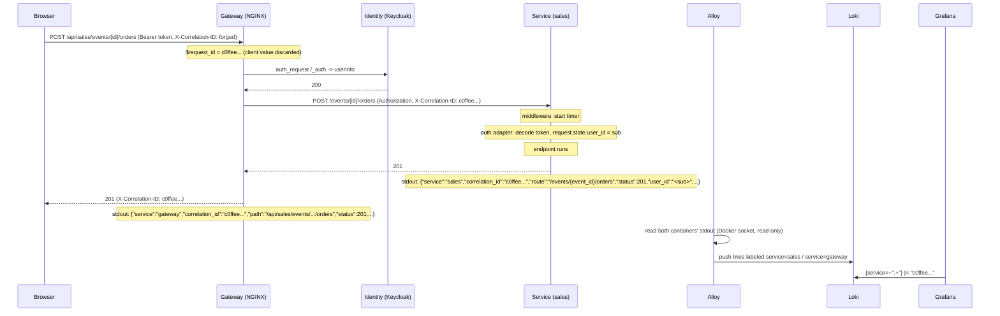

# Design

## Context

See `proposal.md` (Why, What Changes) for motivation and scope, and the five specs under `specs/platform/` for
the required behavior. This document explains how the gateway, the services and the log collection containers
implement them.

Current state that shapes the approach:

- Each service runs `uvicorn <service>.api.main:app` with the default access log: one unstructured line per
  request, with the raw path and query string, and no user or correlation id. The services already have the four
  layers of D-33 (`domain/`, `application/`, `infrastructure/`, `api/`); `api/app.py` builds the FastAPI app with
  `root_path="/api/<service>"`.
- The gateway (`infra/gateway/templates/default.conf.template`) uses the image's `main` log format today.
  `e1-identity-access` (#30, IA-08) replaces it with a `ticketera` format without `$request`, the query string or
  the referrer, sets the error log to `crit`, and leaves the final format to this change with one rule: no
  `$request`, `$args`, `$query_string`, `$request_uri`, `$http_authorization` or `$http_referer`.
- After #30, the gateway validates tokens with `auth_request` and forwards the `Authorization` header unchanged;
  it injects no identity header. Services decode the token payload and key users by `sub` (token-claims contract
  in the design of #30). The gateway itself never learns the `sub`.
- Every route file includes `snippets/forwarded-headers.conf`, so a header set there reaches every service and
  the identity service.
- NGINX has `$request_id`: 16 random bytes as 32 hexadecimal characters, new for every request.
- The `/healthz` location already has `access_log off`.
- `e1-idempotent-purchase` (#32) adds the authentication adapter of `sales` in its `api/` layer and fixes the
  test layout `tests/unit/`, `tests/integration/`, `tests/acceptance/` per service, plus `tests/api/<service>/`
  for Bruno.
- Group 8 showed that machines with about 3 GiB for WSL struggle to start the current seven containers (#24).

## Goals / Non-Goals

**Goals:**

- Follow one request from the browser to the service and back with a single id, in one place (Grafana).
- Measure the duration of every request at the gateway and in the service, so Stages II and III can compare
  before and after (cache, queues, stress test).
- Log authentication failures at both levels: the gateway's `401` and the services' `401` and `403`.
- Make it impossible, by construction, to log tokens, headers, bodies or the query string.
- Add no dependency from the application to the observability stack.

**Non-Goals:**

- Distributed tracing, spans or metrics with OpenTelemetry (rejected in D-23).
- Propagating the correlation id between services: in Stage I no service calls another. Stage II, with
  RabbitMQ, adds it to the messages in its own change.
- Alerting, production retention, or shipping logs outside the local machine.
- Business audit events: this change logs HTTP requests only.
- Showing the correlation id in the frontend.

## Decisions

The Trace column links every D-xx that has an architecture decision record (D-27). RL-xx numbers are local to this
change; IA-xx are the decisions of `e1-identity-access` and DS-xx those of `project-bootstrap`.

| # | Decision | Trace | Alternatives considered (reason rejected) |
| --- | --- | --- | --- |
| RL-01 | Correlation id = NGINX `$request_id`, sent to the service and to the client in `X-Correlation-ID` | D-23 [ADR of D-23][adr-d23] | UUID v4 from njs (one more module for the same entropy); `X-Request-ID` (the PLAN and the specs say "correlation id"; one name everywhere) |
| RL-02 | The forwarding snippet sets the header with `proxy_set_header`, which replaces the client's value; the server returns it with `add_header ... always` | DS-08, IA-07 | Reusing a client id when well formed (lets a client choose ids and mix its requests with others' in queries) |
| RL-03 | Services check the header against `^[0-9a-f]{32}$` and log `null` otherwise | — | Trusting any value from the backend network (a request reaching a service directly could inject text into the log) |
| RL-04 | One request log module per service in `api/request_log.py`, a pure ASGI middleware, about 80 lines; a shared JSON Schema in `tests/platform/request-log.schema.json` checks every service | D-05 [ADR-0004][adr-0004], D-33 [ADR-0005][adr-0005] | Shared Python package (each service builds from its own folder with its own lockfile; a shared path breaks both, and couples releases of independent services); a sidecar per service (a container per service for a few lines of code) |
| RL-05 | Pure ASGI middleware, outermost after Starlette's error middleware, instead of `@app.middleware("http")` | — | `BaseHTTPMiddleware` (runs the endpoint in another task, which hides the request state set by dependencies and has known issues with streaming responses) |
| RL-06 | `user_id` read from the request state, where the authentication adapter of each service stores the accepted `sub`; the middleware never decodes the token | IA token-claims contract | Decoding the token again in the middleware (a second parser that could disagree with the adapter, and would log a `sub` for a request the adapter rejected) |
| RL-07 | `route` = template of the matched route (`scope["route"].path`); `null` when nothing matched | — | Raw path (identifiers of orders and events in the log; unbounded label values in queries) |
| RL-08 | Allow-list of fields, built from scratch for each line; never `request.headers` or `scope` dumps | D-23, OWASP ASVS V7 | Deny-list of sensitive fields (a new header or field leaks until someone adds it) |
| RL-09 | `duration_seconds` with millisecond precision in services and gateway | — | `duration_ms` (NGINX can only print `$request_time` in seconds, and the gateway and services must share units) |
| RL-10 | Uvicorn runs with `--no-access-log`; the middleware writes to stdout with a lock, one `write` per line | — | Keeping both lines (twice the volume, and the Uvicorn line carries the query string) |
| RL-11 | Alloy + Loki + Grafana in the default `docker compose up`, with memory limits (Loki 256 MiB, Grafana 384 MiB, Alloy 128 MiB) and no `depends_on` from application containers | D-23, RB-09 | A Compose profile (a single `docker compose up` would no longer start the whole system, against RB-09); no limits (#24) |
| RL-12 | Alloy reads container logs with `discovery.docker` and `loki.source.docker` through the Docker socket mounted read-only, as root without capabilities, filtered to this Compose project; an exception to DS-13 | D-23 | Loki Docker logging driver (a plugin installed on each member's Docker, outside the repository); a socket proxy (one more image to pin and run, and it mounts the socket too; listed as the upgrade path in the ADR); GELF logging driver of each service sending over UDP to Alloy on `127.0.0.1` (keeps DS-13 and works on Docker Desktop, but adds a `logging` block to every service, a fourth published port and an untested service label; the team chose the socket) |
| RL-13 | Loki stream labels: only `service` (Compose service name); the JSON fields are parsed at query time with `| json` | — | Labels per status or route (high cardinality, which Loki discourages) |
| RL-14 | Retention 7 days with the compactor; data in the named volume `ticketera-loki-data`; Grafana keeps no volume, its data source and dashboard come from provisioning files | D-23 | Unbounded retention (disk grows without limit on member machines); a Grafana volume (state outside the repository) |
| RL-15 | Grafana on `127.0.0.1:${GRAFANA_PORT}`, admin user and password from `.env` with `${VAR:?}`, anonymous access and sign-up off | D-23, DS-10, DS-16 | Grafana behind the gateway (it would need its own access rules inside the API's server block) |
| RL-16 | Three networks: the existing `edge` and `backend`, plus `observability` for Alloy, Loki and Grafana | DS-23 | Joining Loki to `backend` (services do not talk to Loki, so nothing needs that path) |
| RL-17 | Loki image extended with the static BusyBox binary for its healthcheck; its quality labels run `loki -verify-config` | DS-12, DS-18, DS-25 | No healthcheck for Loki (breaks "Every container reports its health"); changing the `quality` job to skip images without labels (a CI change owned by A, and DS-18); an image mount of BusyBox (needs a newer Engine and Compose than the CI runner guarantees) |

[adr-d23]: /docs/adr/adr-0011-bitacora-http-y-observabilidad.md
[adr-0004]: /docs/adr/adr-0004-contenedor-y-base-logica-por-servicio.md
[adr-0005]: /docs/adr/adr-0005-arquitectura-hexagonal.md

The ADR of D-23 is [ADR-0011][adr-d23], written by task 6.1 following the template of the existing ADRs (the
`create-architectural-decision-record` skill was not available). Its number may change when it is merged, as
agreed in the review of #32; this link is updated then. It records RL-01, RL-08, RL-11, RL-12, RL-14 and RL-17:
the log format and excluded fields, the correlation id, the collection stack, its access, its retention, and the
exception to DS-13.

### Decision notes: gateway

- **Log format (RL-01, RL-09).** The template replaces the `ticketera` format of IA-08 with
  `log_format ticketera_json escape=json` and the fields of the api-gateway spec:
  `$time_iso8601`, `gateway`, `$request_id`, `$request_method`, `$uri`, `$status`, `$request_time` and
  `$remote_addr`. `$status` and `$request_time` are written without quotes, so they are JSON numbers. `$uri` is
  the normalized path without the query string, as IA-08 requires; `escape=json` escapes quotes, backslashes and
  control characters, so a decoded `%0A` in the path cannot break the line. The rule of IA-08 stays in the
  template's comment.
- **Every server logs.** The `421` default server gets the same `access_log` line, so rejected host names are
  recorded. `/healthz` keeps `access_log off`.
- **Correlation header (RL-02).** `snippets/forwarded-headers.conf` gets `proxy_set_header X-Correlation-ID
  $request_id;`, so every route, `/auth/` included, sends it. The server block gets
  `add_header X-Correlation-ID $request_id always;` next to the CORS headers, so `401`, `404` and `502` answers
  carry it too. Route files keep using no `add_header` (DS-09). The `auth_request` subrequest shares
  `$request_id` with the main request, so a `401` from the access check has the same id in the response and in
  the log. The preflight `return 204` happens in the rewrite phase, but `add_header ... always` at server level
  still applies to it.
- **Rebase with #30.** Both changes edit the template; whichever merges second rebases. The access log rule of
  IA-08 is a subset of this format, so the rebase only replaces the `log_format` and keeps the `error_log crit`.

### Decision notes: services

- **Middleware (RL-04, RL-05).** `api/request_log.py` defines `RequestLogMiddleware(app, service_name, write)`.
  On `http` scopes it reads the start time with `time.perf_counter()` before calling the inner app, wraps `send`
  to capture the status of `http.response.start`, and after the inner app returns or raises it builds the line
  and calls `write`. If the inner app raises before sending a response, the status is `500` and the exception is
  re-raised so Starlette's error middleware answers it. `lifespan` and `websocket` scopes pass through. The app
  factory adds it last with `app.add_middleware`, so it wraps routing, dependencies and exception handlers.
- **Writer (RL-10).** `write` is a function that serializes with `json.dumps(..., separators=(",", ":"),
  ensure_ascii=True)` and writes the line to `sys.stdout`, looked up at each call, under a module lock, with one
  `write` and a `flush` per line. The lock keeps lines whole under concurrency. A `logging.StreamHandler` was
  dropped because it keeps the stream it was created with, which the tests cannot capture. Any exception inside
  `write` is caught and reported once to stderr without the line, so logging never changes the response (spec:
  Logging never changes the response).
- **User (RL-06).** The authentication adapter of the D-33 skeleton stores the accepted `sub` in
  `request.state.user_id` once it has decoded the token; FastAPI's `request.state` is backed by `scope["state"]`,
  which the middleware reads after the endpoint. A rejected token leaves it unset, so the `401` line has a `null`
  user, and a role failure (`403`) happens after the token was accepted, so its line carries the `sub`. This is the
  only coupling with the authentication code of #32 and of `e1-event-catalog`, and it is written in their task
  lists as one line: "store the accepted `sub` in `request.state.user_id`".
- **Route (RL-07).** Starlette sets `scope["route"]` when a route matches; the middleware reads `.path`, which is
  the template without `root_path`. A `404` from routing leaves it unset.
- **Timestamp.** `datetime.now(UTC).isoformat(timespec="milliseconds")`, taken when the line is built.
- **Uvicorn (RL-10).** The `command` of each service in `docker-compose.yml` and the image's `CMD` get
  `--no-access-log`.

### Decision notes: log collection

- **Alloy (RL-12, RL-13).** `infra/observability/alloy/config.alloy`: `discovery.docker` on
  `unix:///var/run/docker.sock` with a filter on the label `com.docker.compose.project` equal to the project name
  (passed as an environment variable from `COMPOSE_PROJECT_NAME`, default `ticketera`); `discovery.relabel` maps
  `com.docker.compose.service` to the label `service` and drops every other label; `loki.source.docker` sends to
  `loki.write` at `http://loki:3100/loki/api/v1/push`. The socket is mounted with `:ro`; Alloy runs with
  `cap_drop: ALL` and `no-new-privileges`, publishes no port, and joins only `observability`.
- **Exception to DS-13 (RL-12).** DS-13 of `project-bootstrap` says that no container mounts
  `/var/run/docker.sock`, and the smoke test checks that every container runs as a non-root user. Alloy breaks
  both: reading the socket needs its owner, root. The team chose to keep the socket and record the exception
  instead of collecting through the GELF logging driver (alternative below). The exception is limited to Alloy:
  `user: "0:0"` written explicitly, no capabilities (so root cannot override file permissions), no published port,
  only the `observability` network; the smoke test allows root only for the services in `ROOT_ALLOWED_SERVICES`
  (`alloy`). The non-root requirement of `local-environment` covers the containers built by the project, which
  Alloy is not, so no spec changes; DS-13 is amended by this design and the ADR of D-23, which A and C approve in
  the review. Without capabilities root cannot enter the image's `/var/lib/alloy` (owned by the image's `alloy`
  user, mode 770), so the read positions live in the volume `ticketera-alloy-data` at `/alloy-data`, a mount
  point Docker creates owned by root.
- **Loki (RL-14).** `infra/observability/loki/config.yaml`: single binary, filesystem storage under
  `/loki` in the volume `ticketera-loki-data`, `limits_config.retention_period: 168h`, compactor with
  `retention_enabled: true`, authentication off (single tenant, reachable only from `observability`).
- **Grafana (RL-15).** `infra/observability/grafana/provisioning/` with a Loki data source and a dashboard
  provider that loads `dashboards/request-log.json`: requests per service (`sum by (service)
  (count_over_time({service=~".+"} | json | __error__="" | correlation_id != "" [$__interval]))`), requests per
  status class, and p50, p95 and p99 of `duration_seconds` with `quantile_over_time ... | unwrap
  duration_seconds`. `GF_AUTH_ANONYMOUS_ENABLED=false`, `GF_USERS_ALLOW_SIGN_UP=false`, admin user and password
  from `GRAFANA_ADMIN_USER` and `GRAFANA_ADMIN_PASSWORD`.
- **Images and healthchecks.** `grafana/loki:3.7.10`, `grafana/alloy:v1.22.0` and `grafana/grafana:13.3.1`, each
  pinned by index digest with its tag as documentation (DS-25). Each healthcheck uses a tool the image has, as the
  bootstrap did (DS-12): Alloy has `bash`, so it requests `/-/ready` over `/dev/tcp`, as Keycloak does; Grafana
  has `wget` for `/api/health`. Loki's image is distroless (no shell, no HTTP client, no health subcommand), so it
  is extended (RL-17). Loki gets a `start_period` of 60 s and Grafana of 120 s, because Grafana's first start runs
  the migrations of its internal store. Grafana also runs with `GF_PLUGINS_PREINSTALL_DISABLED=true`: otherwise it
  downloads plugins from the internet on every start.
- **Loki image (RL-17).** `infra/observability/loki/Dockerfile` copies the static BusyBox binary into the official
  image, both pinned by digest; the healthcheck calls `busybox wget` on `/ready`. Because the image is built by the
  project, the `quality` job requires its `ticketera.lint`, `ticketera.typecheck` and `ticketera.test` labels
  (DS-18): Loki has no code of the project, so the three run `loki -verify-config` on the configuration.
- **Memory (RL-11).** `mem_limit` of 256 MiB (Loki), 128 MiB (Alloy) and 384 MiB (Grafana), 768 MiB in total,
  the limit of the spec. Measured on a running system: Loki about 100 MiB, Alloy about 90 MiB, Grafana about
  210 MiB, near its first limit of 256 MiB, which made its restart slower than its health window; Grafana got the
  memory Loki did not use.

## API Contracts

This change adds no endpoint and changes no response body, so there is no `openapi.yaml` change and no contract
test. It adds one response header to every gateway answer, `X-Correlation-ID`, and one request header that the
gateway sends to the services. The JSON log lines are the contract of this change; they are defined in the specs
and checked against `tests/platform/request-log.schema.json` (service lines) and
`tests/platform/gateway-log.schema.json` (gateway lines).

## Domain Model

None: this change touches no bounded context's model, aggregates or domain events. The middleware lives in the
`api` layer, an inbound adapter, and the domain and application layers do not know the log exists.

## Sequence Diagram

## Security Threat Analysis (STRIDE)

| Threat | Example | Mitigation |
| --- | --- | --- |
| Spoofing | A client sets its own correlation id to hide among another user's requests or to forge a trail | The gateway always replaces it (RL-02); services accept only the gateway's format (RL-03); a smoke test proves the replacement |
| Spoofing | A client sends `X-User-Id` to be logged as another user | `user_id` comes only from the `sub` accepted by the authentication adapter (RL-06) |
| Tampering | Log injection: a path or header with a quote or line break adds a fake line or field | Gateway `escape=json`; services build the line with `json.dumps`; no client header is logged; the correlation id is format-checked (RL-03) |
| Repudiation | A rejected request leaves no trace | Gateway lines for `401`, `404`, `421` and `502`; service lines for `401`, `403` and every other status |
| Information disclosure | Tokens, cookies, bodies or personal data in the log | Allow-list of fields (RL-08); route templates instead of paths (RL-07); no query string anywhere; tests that fail if a token, a cookie or a body value appears |
| Information disclosure | Anyone on the network reads the logs in Grafana | Grafana only on `127.0.0.1`, credentials from `.env`, anonymous access off (RL-15); Loki publishes no port |
| Denial of service | Log volume fills the disk | 7-day retention (RL-14); one line per request (RL-10) |
| Denial of service | The observability stack exhausts memory on small machines | Memory limits; no application container depends on it (RL-11) |
| Elevation of privilege | The Docker socket gives Alloy, which runs as root, control of the Docker host | Mounted read-only, `cap_drop: ALL`, `no-new-privileges`, no published port, only the `observability` network, and the only container allowed to run as root (RL-12). Read-only does not restrict the Docker API, so the risk is accepted for a local development environment as an exception to DS-13, recorded in the ADR, with a socket proxy or the GELF driver as the upgrade path |

## Test Strategy

| Spec | Where | What |
| --- | --- | --- |
| `request-log` | `services/<service>/tests/unit/test_request_log.py` (each service) | The middleware on a minimal Starlette app: fields and types, route template, `null` route on `404`, `500` on an exception (re-raised), status of `401`/`403`/`422`, `user_id` from `request.state`, duration of a 200 ms endpoint, malformed correlation id, writer failure does not change the response, 50 concurrent requests give 50 whole lines |
| `request-log` | `services/<service>/tests/acceptance/test_request_log_api.py` | The real app with `TestClient`, capturing stdout: one line per request, no Uvicorn line, no token, cookie, query string or body value in the line; every line valid against the shared schema |
| `request-log`, `request-correlation` | `tests/smoke/request-log-checks.sh`, sourced by the smoke test | Through the gateway: `X-Correlation-ID` present and 32 hex, different on two requests, replaced when forged; the same id in exactly one gateway line and one service line (from `docker compose logs`); no Uvicorn access lines; no token in any line after authenticated requests (extends the check of #30 to the services) |
| `api-gateway` | `tests/smoke/request-log-checks.sh` | Gateway lines for `200`, `401`, `404`, `421` and `502` valid against `gateway-log.schema.json`; no line for `/healthz`; a path with `%22` and `%0A` gives one valid line; a query string token never appears |
| `log-collection` | `tests/smoke/request-log-checks.sh` | Loki, Alloy and Grafana healthy; Loki query by correlation id returns both lines within 15 s; Grafana answers `401` without credentials and lists the data source and dashboard with them; Grafana bound to `127.0.0.1` only; memory limits set; stopping the three leaves every route answering |
| `local-environment` | Existing published-ports checks of the smoke test | The list of containers with published ports now includes Grafana; Loki publishes none |
| `request-correlation` | `tests/api/platform/` (Bruno, after the runner of D-24 exists) | Response header present; forged header replaced |

Checked by hand and recorded in the team log: the dashboard with real traffic, and a query by correlation id in
the Grafana UI.

## Risks / Trade-offs

- [Three copies of the middleware drift apart] → The shared JSON Schema and the same unit test list in each
  service; a change to the line format is a change to the schema, which fails every service that was not updated.
- [The `user_id` depends on each service storing the `sub`] → A single line in each authentication adapter, named
  in the tasks of #32 and `e1-event-catalog`; the acceptance test of each service checks it on an authenticated
  endpoint.
- [Smoke test time and CI memory grow with three containers] → Images are small and pulled once per run; the
  smoke test still has to finish within the 15 minutes of the CI requirement, measured in the pull request.
- [Two changes edit the gateway template] → See "Rebase with #30" above.
- [The MODIFIED requirement keeps its title, "Only the gateway and the frontend publish ports", while its text adds
  Grafana] → OpenSpec matches modified requirements by title; renaming it would need a RENAMED entry on a spec
  that is not archived yet. It is renamed when `project-bootstrap` and this change are archived.

## Migration Plan

1. Gateway and services (task groups 1 and 2) can merge before the log collection (group 4): each line is already
   useful in `docker compose logs`.
2. `sales` (group 3) follows the merge of the implementation of #32.
3. Each member adds `GRAFANA_PORT`, `GRAFANA_ADMIN_USER` and `GRAFANA_ADMIN_PASSWORD` to `.env` from
   `.env.example`; startup names any that is missing.
4. Rollback: revert the pull requests; the services go back to the Uvicorn access line, and removing the three
   containers and the `ticketera-loki-data` volume touches no service database.

## Open Questions

None. `catalog` and `payments` get their middleware here, on the current skeleton; `e1-event-catalog` only stores
the `sub` when it adds authentication to `catalog`.
