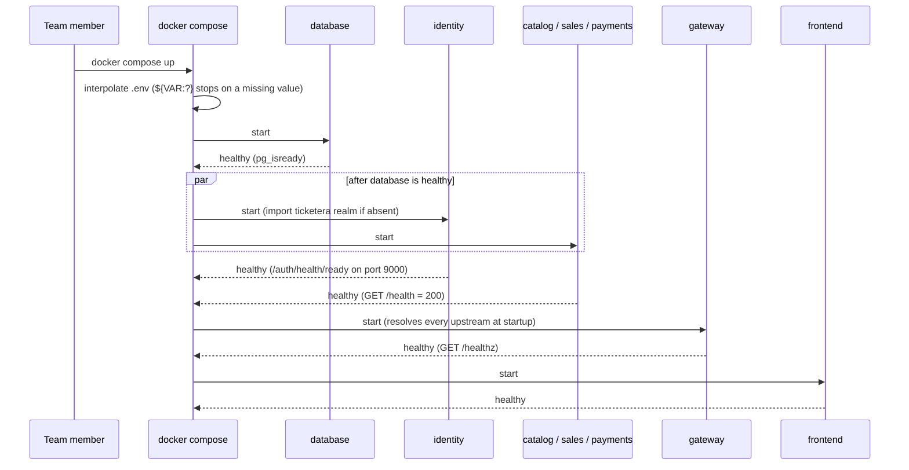
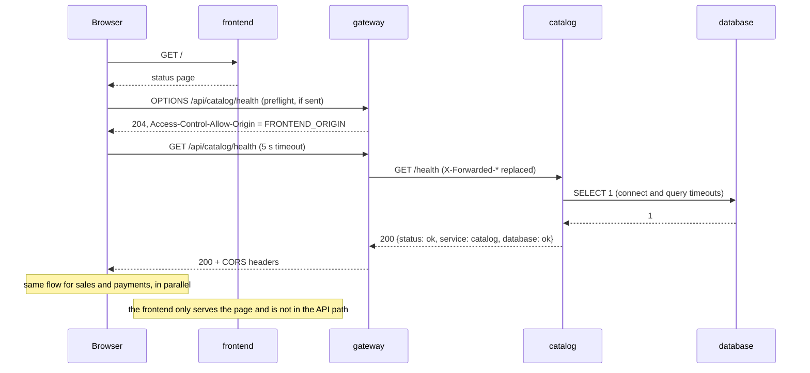
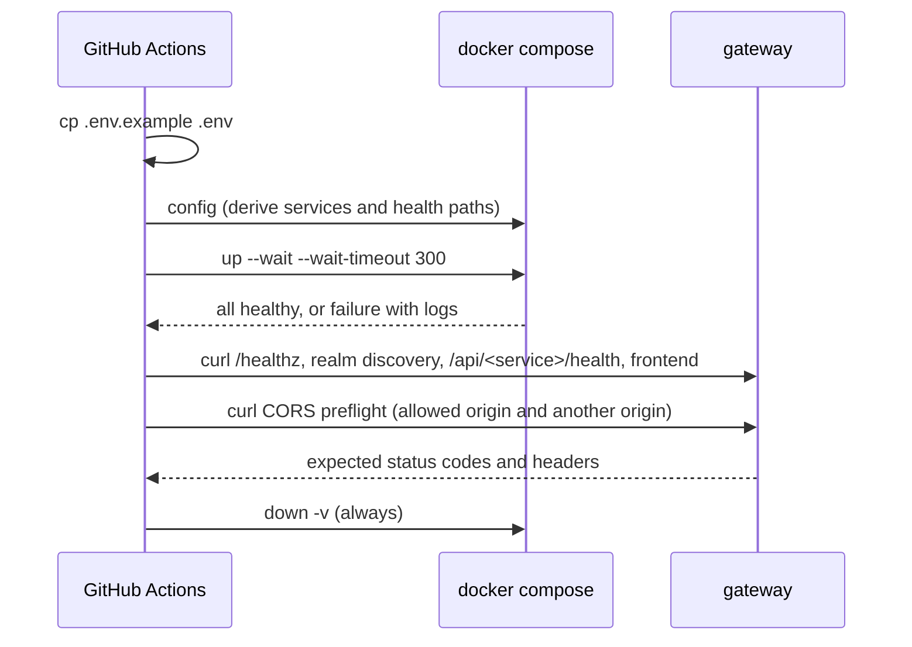

# Design

## Context

See `proposal.md` (Why, What Changes) for motivation and scope, and the seven specs under `specs/platform/` for the
required behavior. This document explains how the walking skeleton and the contribution workflow are built.

Constraints that shape the approach:

- The repository is public and holds only the OpenSpec setup, `docs/PLAN.md` and `.gitattributes` (LF endings).
- Every team member works on Windows with WSL 2 and Docker Desktop; GitHub-hosted runners run Ubuntu.
- Nothing is implemented before the approval pull request (`docs/PLAN.md` v0.4.0, ADR-0001) is merged; the
  decisions referenced below as D-xx are the ones that pull request approves.
- Work is split into nine task groups (proposal, "Bounded Contexts and Responsibility"); groups 3 to 6 run in
  parallel and add to the same compose file, gateway configuration and smoke test.

## Goals / Non-Goals

**Goals:**

- Every behavior in the specs is verifiable either by an automated check (unit tests, smoke test) or by recorded
  GitHub configuration evidence.
- Each service pull request is self-contained: its compose entry, its gateway route and its smoke-test coverage
  arrive together and are visible in the diff.
- Fail fast and loudly: a missing variable, a missing service or a missing route stops startup or fails CI with
  a message naming the cause.
- The same commands run on every member's machine and in CI, inside containers.

**Non-Goals:**

- Production hardening: TLS, Keycloak production mode, image registries, deployment.
- Authentication flows: no OIDC client for the frontend, no token validation in the services (Stage I changes).
- Rate limiting or request logging at the gateway (`e1-request-log`, Stage III).
- Database migrations tooling beyond what the empty skeleton needs.

## Decisions

| # | Decision | Trace | Alternatives considered (reason rejected) |
| --- | --- | --- | --- |
| DS-01 | One container per service in a root `docker-compose.yml`; each service PR adds its own block, route and smoke-test coverage | D-05, PLAN 7.1 | Modular monolith (contradicts D-05); `include:` with one compose file per service |
| DS-02 | One PostgreSQL container with one database per service, owned by the administrator; the service role gets `CONNECT`+`TEMPORARY` and owns its `public` schema; `CONNECT` revoked from `PUBLIC`; extensions installed by the init script | D-06 | One container per database (more memory, no isolation gain in development); service role owning its database (it can grant `CONNECT` to other roles, verified); schema per service in one database (shared database, boundary lost) |
| DS-03 | The init script creates every bootstrap database in task group 2 | D-06 | Each service PR adds its database (the script does not run on existing volumes); init container on every start (more moving parts) |
| DS-04 | Keycloak in `start-dev --import-realm`, with `KC_HTTP_RELATIVE_PATH=/auth`, `KC_HOSTNAME` set to the public gateway URL, `KC_HEALTH_ENABLED=true` (enables the management interface on port 9000) and the bootstrap administrator from `.env` | D-03 | Own identity service with JWT (D-03 alternative); `start` production mode (requires TLS and strict hostname); creating the realm with a script against the admin API (more code to maintain) |
| DS-05 | Realm changes exported with the admin console "Partial export"; future secrets as `${VAR}` placeholders | D-03 | Committing the output of `kc.sh export` (includes users and secrets) |
| DS-06 | Keycloak healthcheck: `GET /auth/health/ready` on port 9000 with `bash /dev/tcp` | D-03 | `curl` (not in the image); discovery document (fallback if "ready" does not imply the import finished); `legacy-observability-interface` (exposes health and metrics on the main port) |
| DS-07 | NGINX with static upstreams: one explicit route per service that strips the prefix, `/auth` to the identity service, local `/healthz`, explicit block of `/auth/health` and `/auth/metrics`; only the expected host names are served (`server_name localhost 127.0.0.1`) and a `default_server` answers `421` to any other `Host` | D-04 | Kong and Traefik (D-04 alternatives); runtime DNS resolution (four reasons, see Alternatives Considered); upstream `resolve` parameter in NGINX 1.27.3/1.28.0 (would start with a missing service) |
| DS-08 | Replace `X-Forwarded-For/Host/Proto` with the real values of the connection | D-04 | Appending to the client's header with `$proxy_add_x_forwarded_for` (lets forged values through) |
| DS-09 | **To confirm at the team meeting.** CORS in the gateway for `/api/*`, with one allowed origin from `.env` (no wildcard); the gateway answers the `OPTIONS` preflight itself, so the services' 405 rule does not break CORS; the identity service client Web Origins are needed in either option | D-01, D-04 | Vite proxy (three reasons, see Alternatives Considered) |
| DS-10 | Only the gateway and the frontend publish ports, on `127.0.0.1`, with the port configurable in `.env`; the database is used only through `docker compose exec` | D-12 | Publishing on `0.0.0.0` (exposed to the network); publishing the Keycloak console and the database port as in the original PLAN 4.4 (unnecessary surface) |
| DS-11 | Hexagonal FastAPI skeleton; `/health` declared with `api_route` for GET and HEAD; `root_path` set to the gateway prefix; `SELECT 1` probe with connect and query timeouts; 503 with `unavailable` | D-02, D-15, D-17 | Traditional layers (D-17 alternative); IETF `application/health+json` format (never became a standard, three fields are enough); 200 with `degraded` (the container would stay healthy without a database) |
| DS-12 | Healthchecks: Python `urllib` in the backends; `pg_isready` in the database; for the gateway, the image `nginxinc/nginx-unprivileged:1.28-alpine` (no project build; pinned by digest per DS-25) with BusyBox `wget -q --spider http://127.0.0.1:8080/healthz`; `bash /dev/tcp` in Keycloak; interval, timeout and retries adding up to at most 60 s | D-12, D-04 | Installing `curl` in the images (more packages, more surface); official `nginx` image (runs as root) |
| DS-13 | Non-root containers; UID/GID as build arguments (default 1000) or tests that do not write into mounted folders; project containers and the gateway run with `security_opt: no-new-privileges:true` and `cap_drop: [ALL]`; no container mounts `/var/run/docker.sock`; database: `no-new-privileges`; database and identity: capabilities per group 2 | D-12 | Running as root (fails the spec); fixed UID 1000 (GitHub runners use 1001); default capabilities (unneeded privileges) |
| DS-14 | Python: uv, Ruff, mypy and pytest; the virtual environment lives in `/opt/venv` inside the image, outside the bind mount and with no anonymous volume; only `node_modules` is an anonymous volume, refreshed with `up --build -V` | D-15 | pip, Poetry, SQLModel, pyright (D-15 alternatives); `.venv` as an anonymous volume (keeps stale dependencies) |
| DS-15 | React + TypeScript + Vite frontend, Vitest + React Testing Library; status page with a 5-second limit per request | D-01, D-16 | Angular and Vue (D-01 alternatives); Jest (D-16 alternative) |
| DS-16 | Required variables with `${VAR:?message}`, no required `env_file` | D-12 | Required `env_file: .env` (the error does not name the missing variable) |
| DS-17 | Live reload with bind mounts and the code inside the WSL 2 file system; polling as a fallback | D-12 | Dev Containers (D-12 alternative) |
| DS-18 | CI workflow: jobs `openspec-validate`, `quality` (a single job) and `smoke-test`; triggers `pull_request` and `push` to `main`; `contents: read`; no `pull_request_target`; `cancel-in-progress` only for pull requests; actions pinned by SHA; OpenSpec 1.14.1; layer cache and each image built once | RB-08, D-15, D-16 | Matrix per service (check names vary and the ruleset cannot require them); path filters (an unreported required check blocks the pull request); `pull_request_target` (runs pull request code with write permissions and secrets) |
| DS-19 | Smoke test that derives the services from `docker compose config` (label with the health path); backends are identified by the build context `./services/<name>`, and one without the label fails the test | RB-09, PLAN 6.4 | Hand-maintained list (can be forgotten) |
| DS-20 | Realm check by JSON keys; `${VAR}` placeholders pass | D-03 | `grep` of values (`client-secret` appears as a value of `clientAuthenticatorType`) |
| DS-21 | Protection of `main`: ruleset with no bypass, squash with "Default to pull request title", automatic deletion of head branches, `CODEOWNERS` with usernames. **"Require branches to be up to date before merging" stays off**; CI on every push to `main` is the backstop (a broken `main` is reverted) | RB-01/04/05/08, D-08, D-13, D-20 | Classic branch protection (no empty bypass list); team in `CODEOWNERS` (requests the team, not the two non-authors); merge commit and rebase (D-13 alternatives); requiring up-to-date branches (serializes groups 3 to 6 and repeats 15 minutes of CI per merge); merge queue (excessive for three people) |
| DS-22 | Convention files: `AGENTS.md` imported by `CLAUDE.md`, pull request template with an AI usage section, pre-commit hooks inside Docker, languages per D-09, MIT `LICENSE` | D-09, D-10, D-11, D-19 | Single assistant (D-10 alternative); no hooks (D-19 alternative); no license (D-11 alternative) |
| DS-23 | Two Compose networks: `edge` (frontend, gateway) and `backend` (gateway, identity service, backend services, database); only the gateway joins both | D-04, D-05 | One default network (the frontend container could reach the database and the services directly) |
| DS-24 | PostgreSQL 18: the named volume is mounted at `/var/lib/postgresql`, as the version 18 image expects | D-06 | The pre-18 path `/var/lib/postgresql/data` (does not match the version 18 image layout) |
| DS-25 | Supply chain: dependencies installed only from lockfiles (`uv sync --frozen` with `uv.lock`, `npm ci` with `package-lock.json`); every base image pinned by digest | D-12, D-15, D-16 | Version ranges or floating tags (a changed dependency or image enters without review) |

### Decision notes by capability

#### platform/contribution-workflow

- The requirements are verified through GitHub configuration and recorded evidence (screenshots or exported
  ruleset JSON in the team log), not automated tests. The evidence that a red required check blocks the merge
  (RB-08) is collected in task group 7.
- Ruleset of `main`: no bypass actors (administrators and organization owners included), pull request required,
  one approval, approval of the most recent push by someone other than its pusher, stale approvals dismissed,
  conversation resolution required, required checks `openspec-validate`, `quality` and `smoke-test`, deletion
  and force push blocked.
- The squash commit takes the pull request title only with the repository setting "Default to pull request
  title" for squash merging; with the default setting a single-commit pull request uses the commit message.
  Merge commits and rebase merges are disabled.
- Branch deletion after the merge depends on the setting "Automatically delete head branches".
- `CODEOWNERS` maps each path to the reviewer of PLAN 6.1. The shared planning files (`docs/PLAN.md`,
  `docs/domain/`, `openspec/config.yaml`) list the three members by username, not the team, so GitHub requests
  the review of the two non-authors; the ruleset still needs one approval, and the second approval on those
  files is enforced in review.
- The branch name, test-first commits, pull request title, `Closes #n` and the AI usage declaration are verified
  in review, not by repository settings. The pull request template lists them as a checklist.
- A required check can be marked required only after the workflow has run once (PLAN 6.4), so group 7 runs right
  after group 2 is merged.

#### platform/local-environment

- PostgreSQL init scripts (`infra/database/`) run only on an empty data volume, so the databases of all bootstrap
  services are created in task group 2 (DS-03). A change to the scripts reaches an existing environment only
  after `docker compose down -v`.
- Healthcheck values: `interval: 10s`, `timeout: 5s`, `retries: 3`. Docker starts each check `interval` after the
  previous one completes, so the worst case from failure to unhealthy is 3 × (10 s + 5 s) = 45 s, inside the
  60-second requirement. `start_period` is 30 s for the backends and the frontend and 120 s for the identity
  service.
- Reload within 10 seconds requires the code inside the WSL 2 file system (D-12); `CONTRIBUTE.md` requires cloning
  under the Linux home directory, never under `/mnt/c`. Polling (`WATCHFILES_FORCE_POLLING`, Vite
  `server.watch.usePolling`) is available through `.env` as a fallback.
- Required variables use `${VAR:?message}`, which stops Compose before any container is created and names the
  variable. `.env` is not declared as a required `env_file`.
- File ownership: GitHub-hosted runners use UID 1001 and members may not use UID 1000. Project images take
  `UID` and `GID` as build arguments (default 1000); tests also avoid writing into mounted folders
  (`PYTHONDONTWRITEBYTECODE=1`, pytest cache provider disabled, coverage data under `/tmp`), so the `quality`
  job does not fail with permission errors.
- The gateway uses the unprivileged NGINX image directly (DS-12), so it also runs as a non-root user; it listens
  on port 8080 inside the container.
- Servers inside containers listen on `0.0.0.0` (uvicorn `--host 0.0.0.0`, Vite `--host`); only the published
  port is bound to `127.0.0.1`.
- `.env` is listed in `.gitignore`; `.env.example` holds placeholder values that work locally and in CI, and is
  the template of every variable.
- Networks (DS-23): the frontend joins only `edge`; the database, the identity service and the backend services
  join only `backend`; the gateway joins both. The browser reaches the gateway through its published port, so
  the frontend container never needs the internal network.
- Hardening (DS-13): `no-new-privileges` and `cap_drop: [ALL]` apply to the containers built by the project and to
  the gateway. `no-new-privileges` also applies to the database, whose entrypoint drops privileges with `gosu`.
  For PostgreSQL, task group 2 records `cap_drop: [ALL]` plus the minimal `cap_add` set its entrypoint needs
  (ownership and user changes at startup). The identity service already runs as a non-root user on a port above
  1024, so task group 2 tries `cap_drop: [ALL]` on it before excluding it.
- PostgreSQL 18 (DS-24): the named volume `ticketera-db-data` is mounted at `/var/lib/postgresql`.
- Supply chain (DS-25): images use `FROM <image>@sha256:<digest>` and compose uses `image: <image>@sha256:<digest>`;
  updating a digest or a lockfile is a pull request of its own or part of the change that needs it.

#### platform/api-gateway

- Configuration lives in `infra/gateway/`, with one route file per service (`routes/<service>.conf`) included by
  the main configuration, so parallel service pull requests do not edit the same lines.
- Each route is `location /api/<service>/ { proxy_pass http://<service>:8000/; }`: the trailing slash strips the
  prefix, and the host name is resolved at startup, so a route to a missing service stops NGINX from starting.
- Host names: the server block that routes traffic declares `server_name localhost 127.0.0.1`; a separate
  `default_server` answers `421 Misdirected Request` to any other `Host` without forwarding, which defeats DNS
  rebinding. `server_name` matches the host name without the port, so `localhost:<port>` from the browser is
  served. The container healthcheck uses `127.0.0.1`, so it matches the routing server block.
- Requests inside the Docker network that use the container name (`Host: gateway`) also get `421`. Internal
  callers must not go through the gateway: the healthcheck uses `127.0.0.1`, and the services reach the identity
  service directly on the `backend` network.
- Static upstream resolution: a recreated service container may get a new IP, and the gateway answers 502 until
  it restarts. `CONTRIBUTE.md` documents `docker compose restart gateway`.
- The gateway blocks `/auth/health` and `/auth/metrics` explicitly (`return 404`) as defense in depth: those
  endpoints normally live on the management port, which the gateway never routes, but the deprecated
  `legacy-observability-interface` option would expose them on the main port.
- Forwarding (DS-08): `X-Forwarded-For $remote_addr`, `X-Forwarded-Host $http_host`, `X-Forwarded-Proto $scheme`;
  client values are replaced, never appended.
- The issuer is fixed with `KC_HOSTNAME` to the public gateway URL (`http://localhost:${GATEWAY_PORT}/auth`).
  Backend services will fetch keys over the internal network but validate `iss` against the public URL.
- Each FastAPI service sets `root_path` to its gateway prefix (`/api/<service>`), so its OpenAPI documentation
  works through the gateway.
- DS-09, CORS: the allowed origin comes from `FRONTEND_ORIGIN` in `.env` (default `http://localhost:5173`),
  injected with the image's template substitution. A `map` sets the allowed origin only when `$http_origin`
  equals it; otherwise no `Access-Control-Allow-Origin` header is sent. `Vary: Origin` is always sent. `OPTIONS`
  requests under `/api/` are answered by the gateway with `204` and never forwarded.
- DS-09 interaction with forwarding: with CORS, the browser reaches the gateway directly and the replacement rule
  of DS-08 stays unconditional. With a Vite proxy, the gateway would see the frontend container as the client
  and would have to trust `X-Forwarded-*` only from that container.
- The two CORS preflight scenarios of `platform/api-gateway` depend on the DS-09 decision; if the team chooses
  another option, they must be revised with `/opsx:update` before implementation. The smoke test checks both
  with `curl`.

#### platform/database-isolation

- Each service database is owned by the database administrator. The service role gets `CONNECT` and `TEMPORARY`
  on its database and owns its `public` schema, so it can run migrations but cannot grant access to the
  database. A role that owns the database could grant `CONNECT` to other roles (verified).
- The init script revokes `CONNECT` on every service database from `PUBLIC`; without it any role could connect
  to any database.
- Service roles have `NOSUPERUSER NOCREATEDB NOCREATEROLE`. They cannot install extensions, not even trusted ones
  such as `pgcrypto`, because that needs `CREATE` on the database; any extension a service needs is installed by
  the init script as administrator.
- The passwords of each role come from `.env`; the init script reads them from the environment and never writes
  them into the repository.

#### platform/identity-provisioning

- The identity service starts with `--import-realm`; the realm definition is mounted read-only from
  `infra/keycloak/` into the import folder. The import is skipped when the realm already exists.
- Bootstrap administrator: created from `KC_BOOTSTRAP_ADMIN_USERNAME` and `KC_BOOTSTRAP_ADMIN_PASSWORD`
  (`${VAR:?message}`) only on the first start, when the master realm does not exist. Changing it needs
  `docker compose down -v` or the admin console. Keycloak marks it as temporary; this is a difference from a real
  environment.
- The identity service connects to its own `keycloak` database with its own role (DS-02).
- Realm changes are exported with the admin console "Partial export", which masks secrets and excludes users.
  The output of `kc.sh export` is never committed. A change to the definition reaches an existing environment
  only after `docker compose down -v`; `CONTRIBUTE.md` explains both.
- Future secrets in the realm definition use `${VAR}` placeholders resolved from `.env` at import time.
- Healthcheck: the image has no `curl`; the check opens `/dev/tcp/127.0.0.1/9000` with `bash` and requests
  `/auth/health/ready`, because the management interface inherits the `/auth` relative path. Task group 2
  verifies that "ready" implies the import finished; if not, the check requests the realm discovery document.

#### platform/service-health

- FastAPI does not add HEAD to a GET route (verified with FastAPI 0.143: HEAD answers 405). The route is declared
  with `api_route` and methods GET and HEAD, and HEAD has its own test.
- The database probe runs `SELECT 1` with a connect timeout and a query timeout (`statement_timeout`, TCP
  keepalives), so a connection already in the pool cannot hang beyond 3 seconds; the endpoint answers 503 as soon
  as the probe fails or times out.
- The container healthcheck calls the same `GET /health` with Python `urllib`, so a service without its database
  becomes unhealthy, as `platform/local-environment` requires.
- The 1-second and 3-second limits are project metrics, not values from the plan.
- The status page calls each health endpoint with its own `AbortController` and a 5-second timeout, so one slow
  service does not delay the others.

#### platform/continuous-integration

- Each check name is the `name` of a job; `quality` is a single job that loops over the services, not a matrix.
- `openspec-validate` runs `npx @fission-ai/openspec@1.14.1 validate --all --strict --no-interactive` inside a
  Node.js container, pinned to that version.
- `quality` builds every image, then runs lint, type check and tests of each service with `docker compose run`,
  printing the service and step before each command. It also runs the realm check: a script that inspects JSON
  keys (`secret`, `privateKey`, `credentials`, ...), not values, because `client-secret` appears as the value of
  `clientAuthenticatorType`; a `${VAR}` placeholder passes.
- `smoke-test` runs `docker compose up --wait --wait-timeout 300`, then checks with `curl`: `/healthz`, the realm
  discovery document, every backend health endpoint, the frontend, and the two CORS preflight scenarios. On
  failure it prints `docker compose logs` of the unhealthy containers. `docker compose down -v` runs in a step
  with `if: always()`.
- The smoke test derives the services to verify from `docker compose config` (label `ticketera.health-path`).
  Backend services are identified independently of the label, as every Compose service built from
  `./services/<name>`; one without the label fails the test, naming it.
- The frontend joins the smoke test with its own pull request (task group 4).
- Third-party actions are pinned to full commit SHAs. `permissions: contents: read` at workflow level.
- `concurrency` is grouped per pull request, and `cancel-in-progress` applies only when
  `github.event_name == 'pull_request'`; every commit on `main` runs its checks to completion.
- Docker layers are cached between runs (BuildKit cache), and each image is built once per job, to stay under
  15 minutes.
- Repository setting: keep "Require approval for first-time contributors" (or for all outside collaborators) for
  pull requests from forks.

## Alternatives Considered

Every decision above lists its alternatives with the reason for rejection. These need more than one line:

**Runtime DNS resolution in NGINX (rejected for DS-07):**

1. It hides a missing service as a runtime 502 instead of failing at startup.
2. `proxy_pass` with variables changes URI handling and needs explicit rewrites that are harder to review.
3. The gateway uses a generic route, so a pull request that adds a service does not touch the gateway
   configuration and the reviewer cannot see the new public route in the diff.
4. It ties the gateway configuration to Docker's embedded DNS (`resolver 127.0.0.11`).

**Vite proxy for same-origin access (rejected for DS-09):**

1. It does not remove CORS from the identity service: the SPA token request goes to the token endpoint of the
   issuer, the public gateway URL, so the client Web Origins are needed anyway.
2. It weakens the `X-Forwarded-*` replacement rule (DS-08): the gateway would have to trust those headers from the
   frontend container.
3. It disappears with a static build of the frontend.

**Service role owning its database (rejected for DS-02):** the owner of a database can run
`GRANT CONNECT ON DATABASE catalog TO sales`, after which the `sales` role connects to the `catalog` database.

**Requiring branches to be up to date before merging (rejected for DS-21):** with groups 3 to 6 in parallel,
every merge would force the other open pull requests to update and rerun up to 15 minutes of CI; CI on every push
to `main` catches the rare semantic conflict, and the commit is reverted.

## API Contracts

### Health endpoint (every backend service)

```yaml
openapi: 3.1.0
info:
  title: Service health
  version: 1.0.0
paths:
  /health:
    get:
      summary: Service status and database connectivity
      security: []
      responses:
        "200":
          description: The service can reach its database
          content:
            application/json:
              schema: { $ref: "#/components/schemas/Health" }
              example: { status: ok, service: catalog, database: ok }
        "503":
          description: The service cannot reach its database
          content:
            application/json:
              schema: { $ref: "#/components/schemas/Health" }
              example: { status: unavailable, service: catalog, database: unavailable }
    head:
      summary: Same status code as GET, no body
      security: []
      responses:
        "200": { description: Healthy }
        "503": { description: Database unreachable }
components:
  schemas:
    Health:
      type: object
      additionalProperties: false
      required: [status, service, database]
      properties:
        status: { type: string, enum: [ok, unavailable] }
        service: { type: string, examples: [catalog, sales, payments] }
        database: { type: string, enum: [ok, unavailable] }
```

Any other method answers `405 Method Not Allowed`.

### Gateway routes

| Public path | Destination | Notes |
| --- | --- | --- |
| `/healthz` | Gateway itself | `200 OK`, never forwarded |
| `/api/catalog/...` | `catalog:8000/...` | Prefix removed; CORS for `FRONTEND_ORIGIN` |
| `/api/sales/...` | `sales:8000/...` | Same |
| `/api/payments/...` | `payments:8000/...` | Same |
| `/auth/...` | `identity:8080/auth/...` | Includes `/auth/admin/` |
| `/auth/health`, `/auth/metrics` | None | `404 Not Found` |
| Anything else | None | `404 Not Found` |

### Integration events

None: the skeleton has no domain behavior.

## Sequence Diagrams

### Ordered startup



### Status page



### Smoke test in CI



## Security Threat Analysis

| STRIDE | Threat | Mitigation |
| --- | --- | --- |
| Spoofing | A client forges `X-Forwarded-For` to impersonate another address | DS-08 replaces forwarding headers |
| Spoofing | Someone uses the Keycloak admin console | Console only through the gateway on `127.0.0.1`; bootstrap credentials only in `.env` |
| Spoofing / Information disclosure | DNS rebinding: a malicious website rebinds its domain to `127.0.0.1` and reads gateway responses as same origin | The gateway serves only `localhost` and `127.0.0.1`; a `default_server` answers `421` to any other `Host` (DS-07); Vite's default `server.allowedHosts` protects the frontend |
| Tampering | Direct or force push to `main` | Ruleset with no bypass (DS-21) |
| Tampering | A compromised third-party action | Actions pinned by SHA; read-only token |
| Tampering | A malicious or changed dependency or base image | Lockfiles installed with `uv sync --frozen` and `npm ci`; every base image pinned by digest (DS-25) |
| Tampering | A fork pull request runs code with write access | No `pull_request_target`; `contents: read`; approval for first-time contributors |
| Repudiation | Unclear authorship of changes or AI usage | Squash commits with pull request titles; required reviews; AI usage section; request log comes in `e1-request-log` |
| Information disclosure | Secrets committed to the public repository | `.env` ignored; placeholders only; realm check in `quality`; review |
| Information disclosure | Internal details in health responses | Three-field body only (DS-11) |
| Information disclosure | Database or identity internals reachable | No published ports for them; `/auth/health` and `/auth/metrics` blocked |
| Denial of service | A slow service blocks the status page | 5-second timeout per request; probe timeouts below 3 seconds |
| Elevation of privilege | Container breakout as root | Non-root containers (DS-12, DS-13) |
| Elevation of privilege | A process in a container gains privileges or controls the Docker host | `no-new-privileges:true`, `cap_drop: [ALL]` on project containers and the gateway; no container mounts `/var/run/docker.sock` (DS-13) |
| Elevation of privilege | A compromised frontend container reaches the database or the services | Network segmentation: the frontend joins only `edge` (DS-23) |
| Elevation of privilege | One service reads another's data | Database ownership by administrator, `CONNECT` revoked from `PUBLIC`, no extensions for service roles (DS-02) |
| Elevation of privilege | Any website calls the API from a browser | CORS with a single allowed origin, no wildcard, no echo (DS-09) |

## Domain Model and Concurrency

Not applicable: the change has no domain behavior, stock, orders or payments. Tactical DDD, integration events and
the concurrency and idempotency strategy start with the first e1-* change.

## Risks / Trade-offs

- [The team changes a gated decision or DS-09 at the meeting] → Update the specs, this design and the tasks with
  `/opsx:update` before implementation starts.
- [The repository is cloned under `/mnt/c`: slow mounts, no file events, no reload] → `CONTRIBUTE.md` requires a
  clone inside WSL; polling fallback; group 8 checks every machine.
- [CRLF line endings break shell scripts (`/bin/sh^M`)] → `.gitattributes` forces LF; `.editorconfig` added in
  group 1.
- [Host ports already in use or reserved by Hyper-V] → Ports configurable in `.env`, with uncommon defaults.
- [Keycloak starts slowly and `up --wait` times out] → `start_period: 120s`; memory guidance for `.wslconfig` in
  `CONTRIBUTE.md`.
- [Docker Desktop WSL integration disabled for the distribution] → Listed as a prerequisite in `CONTRIBUTE.md`.
- [Stale `node_modules` in the anonymous volume after a dependency change] → `docker compose up --build -V`.
- [WSL clock drifts after sleep; tokens rejected later] → Documented; relevant from the first change with
  authentication.
- [A recreated service gets a new IP and the gateway answers 502] → `docker compose restart gateway`, documented.
- [A realm change does not reach an existing environment] → `docker compose down -v`, documented.
- [UID mismatch between members and CI] → UID/GID build arguments; tests do not write into mounted folders.
- [Parallel pull requests of groups 3 to 6 conflict] → One route file per service; each pull request adds only
  its own compose block; rebase on `main` before review.
- [`main` breaks after two compatible-looking merges, since up-to-date branches are not required] → CI on every
  push to `main`; revert the commit.
- [CI exceeds 15 minutes] → Layer cache, each image built once, `cancel-in-progress` on pull requests.
- [The bootstrap administrator is temporary and created only once] → Documented as a difference from a real
  environment.

## Migration Plan

1. Open the planning pull request (`feature/project-bootstrap-plan`, this change) as a draft and review it at the
   team meeting.
2. Merge the approval pull request (`docs/PLAN.md` v0.4.0). It sets the gated decisions to Approved in section 5,
   records them in `docs/adr/ADR-0001`, updates PLAN 4.4 (published ports, the Python virtual environment in the
   image, the PostgreSQL 18 volume path `/var/lib/postgresql`), PLAN 7.1 (D-17 in the gate list) and PLAN 7.2
   (the domain decisions become ADR-0002), and adds the entry to the change log in section 11.
3. Run `/opsx:update` to fold the meeting outcomes (DS-09 included) into the proposal, specs, design and tasks.
4. Mark the planning pull request ready, review and merge it.
5. Group 1: convention files, `LICENSE`, `.env.example` skeleton.
6. Group 2: database with all bootstrap databases, identity service, gateway, smoke test (red first), CI workflow.
7. Group 7: mark `openspec-validate`, `quality` and `smoke-test` as required, right after group 2 is merged.
8. Groups 3 to 6 in parallel: each adds its service or the frontend, its route and its smoke-test coverage.
9. Group 8: onboarding on a clean clone on every member's machine; fixes get their own pull requests.
10. Group 9: verification, evidence of groups 7 and 8, `openspec validate --all --strict`, archive.

Rollback: each group is one squash commit, reverted with `git revert` in reverse dependency order: groups 3 to 6
before group 2, and group 2 before group 1. Before reverting group 2, which removes the CI workflow, undo group 7
in the ruleset; otherwise the required checks are never reported and every pull request, the revert included,
stays blocked. Local state is removed with `docker compose down -v`.

## Open Questions

None. DS-09 is a decision to confirm at the team meeting, not an open question: if it changes, the specs and this
design are updated before implementation.
